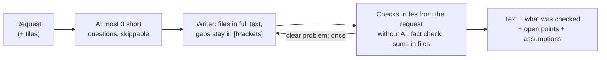

# Geef.Atelier

*[Deutsch](README_de.md) · **English***

**Atelier turns a short request into a finished text** – a letter, an email, an article, a summary, a report. You say what you
need, add files if you have them, and get the text together with what was checked, what is still open and what was assumed.
It runs in the browser and from AI assistants such as Claude Code (over MCP). It is built on the open [Geef SDK](https://github.com/chr0mcom/geef).

## How it works, in one picture



The running application explains itself on two public pages. The **start page** (`/`) says in short what Atelier does, shows a
made-up example from request to text with gaps and open points, names what it does not do and leads each audience (people at home,
clubs and schools, small offices, AI-assistant users, administrators and developers) to the right part of **How it works**
(`/how-it-works`). Both pages read the current switches (and a signed-in person's exceptions), so neither shows a feature as
available that is switched off (D-080, D-084).

## Who it is for

| You … | Start here |
|---|---|
| want a text and use the browser | [Guide: writing with Atelier](docs/12-user-guide.md) |
| use an AI assistant (tested with Claude Code) | [Guide: from an AI assistant](docs/13-ai-assistant-guide.md) |
| run Atelier for a team: accounts, switches, the older workshop | [Guide for administrators](docs/14-admin-guide.md) |
| develop or host it | [Guide for developers and hosts](docs/15-developer-guide.md) |

## What it does around the writing – and what not

Each point names the decision that describes it.

- **Gives the writer whole files.** Up to 150,000 characters the writer gets the files completely, nothing shortened first; up to
  600,000 it gets a table of contents and searches the parts that matter. If it seems to have read only parts, the result says so
  (D-069, D-070).
- **Asks before, not after.** At most three short questions with answers to click, only before the start, always skippable; what
  it does not ask is listed as an assumption (D-068, D-071, D-072). In a small measurement (eleven jobs by one person, judged
  blind by AI jurors) asking beat merely assuming 9 : 1 (D-068).
- **Leaves gaps visible.** Guesses about facts the person did not give reach the writer marked as "not given", and the writer is
  asked to leave placeholders; the result lists them under "Fill these in before you send the text" (D-069, D-073).
- **Says what was checked – and what not.** On the standard way, "What was checked" lists only checks that ran and ends with the sentence that they do
  not prove the text is right. The fact check points out passages that may not be backed; in the shipped setting it does not
  change the text (D-073).
- **One place for every version.** Orders, versions and exports (Word, PDF, Markdown) in the web app and over MCP (D-070, D-075).

Limits: the text can still be wrong; the fact check can miss things and also flags harmless sentences (D-075); Atelier is not a
chat; it does not learn from earlier texts (learning paused, D-067; memory not built, D-077); scans without text cannot be read
(D-076); "Extra careful" uses the older loop, does not search the web and has no "What was checked". On the standard way Atelier
may look things up on the web, for orders without files and only with short topics from the request; passages it found can still
be wrong and are shown with their page (D-074, switched on for everyone after its measurement passed). A finished text can be
changed ("Change something", D-078).
Teams chosen explicitly in the workshop can use their own web search.

## Read on

| Document | Content |
|---|---|
| [docs/README.md](docs/README.md) | Index of all documents |
| [docs/05-decisions-log.md](docs/05-decisions-log.md) | Every design decision and measurement, most recently D-067 to D-077 |
| [docs/02-architecture.md](docs/02-architecture.md) | Layers, data model, safeguards, switches |
| [docs/04-mcp-integration.md](docs/04-mcp-integration.md), [docs/09-endpoint-reference.md](docs/09-endpoint-reference.md) | MCP tools and HTTP endpoints in detail |

---

## Local startup

```bash
# Start app + Postgres
docker compose -f docker-compose.dev.yml up --build -d

# Health check
curl http://localhost:8080/health   # → Healthy

# Stop the stack
docker compose -f docker-compose.dev.yml down
```

## Auth setup

### Users

The app supports multiple user accounts. The first admin account is set automatically from env vars and is created or synchronized on startup:

```bash
# Generate a BCrypt hash for a password (work factor 11)
dotnet run --project tools/HashPassword -- "YourPassword"
# Output: $2a$11$...
```

```env
ATELIER_USER=<admin-username>
ATELIER_PASSWORD_HASH=$2a$11$...
```

Further users can be created in the admin panel at `/admin/users` (visible only to the admin account).

**Dev defaults** (local development only, in `docker-compose.dev.yml`):
- Username: `admin`
- Password: `DevPassword!`

### MCP token (Claude Code CLI)

```bash
# Generate a random token
openssl rand -hex 32
```

```env
ATELIER_MCP_TOKEN=<hex-token>
```

---

## Tests

```bash
# Requires a running Docker daemon (Testcontainers)
dotnet test
```

## Run a migration manually

```bash
dotnet ef database update \
  --project src/Geef.Atelier.Infrastructure \
  --startup-project src/Geef.Atelier.Web
```

---

## MCP server

The MCP server is served at `/mcp`. Two auth paths are available in parallel:

### Path A: Static bearer token (Claude Code CLI)

```json
{
  "mcpServers": {
    "geef-atelier": {
      "url": "https://<your-domain>/mcp",
      "transport": "streamable-http",
      "auth": {
        "type": "bearer",
        "token": "<ATELIER_MCP_TOKEN>"
      }
    }
  }
}
```

### Path B: OAuth 2.1 (Claude Desktop / Claude.ai custom connector)

Enter the URL `https://<your-domain>/mcp` in the client — the client detects the `WWW-Authenticate` header carrying the resource-metadata URL and starts the OAuth flow automatically (dynamic client registration → browser login → consent page → token exchange).

Prerequisite: the OAuth client must be registered in the admin panel at `/admin/oauth-clients`, or the client registers itself via dynamic client registration (`POST /oauth/register`).

### MCP tools

The order tools (`submit_order`, `answer_order`, `get_order_status`, `get_order_result`, `revise_order`, `export_order`,
`cancel_order`, `list_orders`, `profile`) and, while `Uploads:Tickets` is `On`, `prepare_attachment`. While `Mcp:LegacyTools` is
`true` (shipped), the older workshop tools are offered as well. Overview: [docs/13-ai-assistant-guide.md](docs/13-ai-assistant-guide.md)
(the tool table there is checked against the server by a test); contracts: [docs/04-mcp-integration.md](docs/04-mcp-integration.md),
[docs/09-endpoint-reference.md](docs/09-endpoint-reference.md).

---

## The older workshop: crew system

This is the way of working from before the rebuild of November 2026; "Extra careful" and the older tools still use it. Every run of it uses a configurable crew of an executor (writes the draft) and reviewers (assess the draft). The default template `"klassik"` reproduces the original behaviour with two reviewers running in parallel.

**Available evaluation strategies:** `Parallel` (default), `Sequential`, `FailFast`, `Priority`.

**System profiles** are versioned in code and read-only. **Custom profiles** can be created via `ICrewService` or MCP and are stored in the DB.

Every run stores a fully embedded **CrewSnapshot** in the DB — so the run stays reproducible even if profiles are changed later.

**Model matrix (D-066):** profiles declare a role (`ModelSlot`) and crews a domain; the system assigns each managed actor its model from `ModelMatrix` at run start.

- Claude always runs via `claude-cli` and OpenAI via `codex-cli`.
- Managed reviewers avoid the executor's model (shared only with a logged warning when no other candidate is usable) and prefer another vendor family; a manually bound reviewer keeps its model and is only warned.
- Profiles set to "Manual" keep their chosen model.

See [docs/08-crew-system.md](docs/08-crew-system.md).

### Crew management in the UI

| Page | URL |
|-------|-----|
| Crew overview | `/crew` |
| Template list | `/crew/templates` |
| Create/edit template | `/crew/templates/new`, `/crew/templates/{name}` |
| Reviewer profiles | `/crew/profiles/reviewers` |
| Executor profiles | `/crew/profiles/executors` |
| Grounding providers | `/crew/profiles/grounding-providers` |
| Finalizer profiles | `/crew/profiles/finalizers` |
| Template Studio (AI-assisted template creation) | `/crew/studio` |

These pages are reached through the menu "Workshop", which only administrators see while `Ui:WorkshopForAdminsOnly` is on (shipped); the addresses themselves stay open to every signed-in user as before (D-077).

Details: [docs/08-crew-system.md](docs/08-crew-system.md)

---

## Production deployment

Prerequisites: Traefik is running on the server, the domain's DNS points to the server.

### Initial setup

**1. Generate secrets:**

```bash
# BCrypt hash for the UI password (work factor 11)
dotnet run --project tools/HashPassword -- "YourPassword"

# MCP token (64 hex characters)
openssl rand -hex 32

# Postgres password
openssl rand -base64 24
```

**2. Create the `.env` file** (never commit to Git — it is gitignored):

```env
POSTGRES_DB=geef_atelier
POSTGRES_USER=geef_atelier
POSTGRES_PASSWORD=<generated-password>

ATELIER_USER=<admin-username>
ATELIER_PASSWORD_HASH=<bcrypt-hash>
ATELIER_MCP_TOKEN=<hex-token>
ATELIER_DOMAIN=<your-domain>

LLM_OPENROUTER_API_KEY=<openrouter-api-key>

# Tavily web search (https://tavily.com) — needed for looking things up on the standard way (Research:Mode, shipped On) and for
# the tavily, news-search and tavily-news grounding profiles; without a key also set Research__Mode=Off
TAVILY_API_KEY=
```

**3. Start the stack:**

```bash
docker compose up -d --build
```

Migrations run automatically on startup. Health check: `https://<your-domain>/health`.

### Restart / update

```bash
docker compose build --no-cache web && docker compose up -d web
docker compose logs -f web
```

### Important URLs

| URL | Description |
|-----|--------------|
| `https://<your-domain>/` | Web UI (cookie auth) |
| `https://<your-domain>/how-it-works` | Public explanation page; follows the current switches |
| `https://<your-domain>/health` | Health check |
| `https://<your-domain>/mcp` | MCP endpoint (bearer / OAuth 2.1) |
| `https://<your-domain>/admin/users` | User management (admin only) |
| `https://<your-domain>/admin/oauth-clients` | OAuth client management (admin only) |
| `https://<your-domain>/.well-known/oauth-authorization-server` | OAuth server metadata |

---

## Backup & restore

The `postgres-backup` container creates daily backups automatically.

- **Schedule:** daily at 03:00 UTC
- **Retention:** 7 daily, 4 weekly, 6 monthly snapshots
- **Location:** Docker volume `geef-atelier-backups`
- **Format:** `.sql.gz` (gzip-compressed pg_dump)

```bash
# Trigger a backup manually
docker compose exec postgres-backup /backup.sh

# Inspect backups
docker compose exec postgres-backup ls -lh /backups/last/

# Copy a backup out of the volume
docker cp geef-atelier-postgres-backup:/backups/last/<file>.sql.gz ./
```

### Restore

```bash
docker compose stop web
./scripts/restore-backup.sh <path-to-backup-file.sql.gz>
curl https://<your-domain>/health
```

> **Note:** `scripts/restore-backup.sh` overwrites all existing data. Take a fresh copy before restoring.

---

## Project structure

```
src/
  Geef.Atelier.Core/           Domain entities, interfaces — no external dependencies
  Geef.Atelier.Application/    IRunService, IOAuthService, IUserAdminService, etc.
  Geef.Atelier.Infrastructure/ EF Core, Npgsql, LLM clients, Geef.Sdk provider impl.
  Geef.Atelier.Web/            Blazor Server, BackgroundService, endpoints, MCP server
  Geef.Atelier.Mcp/            MCP tool definitions (class library)
tests/
  Geef.Atelier.Tests/          xUnit + Testcontainers + bUnit
tools/
  HashPassword/                BCrypt hash generator CLI
docs/
  reports/                     Completion reports per build step
```

## Stack

- .NET 10 / Blazor Server / Minimal API
- PostgreSQL 16 + pgvector via `Npgsql.EntityFrameworkCore.PostgreSQL`
- [Geef.Sdk 1.0.0-ci.1](https://www.nuget.org/packages/Geef.Sdk/) (prerelease)
- Docker / Traefik

---

## History of the build (historical)

The list below records how the project grew. It is kept for provenance; the current state is described above and in the guides.

**Step 1 ✅** Solution structure, Postgres persistence, health check, Docker Compose.

**Step 2 ✅** In-memory Geef pipeline with stub providers — no LLM, no DB access. Convergence loop, event sink, all four provider contracts implemented and covered by xUnit tests.

**Step 3 ✅** Real Anthropic API calls — `IAnthropicClient`, `LlmExecutionStep`, two `LlmReviewer` (tool use). Polly resilience.

**Step 4 ✅** Postgres persistence — `PostgresEventSink` writes every pipeline run with its iterations, findings, token usage and event log to the DB.

**Step 5 ✅** BackgroundService orchestration — `RunOrchestratorService` polls for pending runs, sets an atomic claim, runs the Geef pipeline concurrently, and recovers crashed runs on startup.

**Step 6 ✅** Application service layer — `IRunService` (Submit/Get/List/Cancel), `IRunRepository`, cancellation watcher.

**Step 7 ✅** Blazor UI — three pages (`/new`, `/runs`, `/runs/{id}`), SignalR hub with live status, 9 UI components, bUnit and Playwright tests.

**Step 8 ✅** Cookie auth — single-user login, `[Authorize]` on pages, login/logout, `TestAuthenticationHandler` for E2E tests.

**Step 9+ ✅** Crew system, advisor passes, Template Studio (with full-field edit, D-043), domain templates, grounding-provider CRUD, vector-store RAG, PDF support, cost tracking.

**MCP OAuth ✅** Self-hosted OAuth 2.1 authorization server (RFC 8414/7591/7636/7009/8252) — authorization-code flow with mandatory PKCE/S256, opaque tokens, refresh rotation, reuse detection.

**Multi-user ✅** DB-based user management with BCrypt, admin UI at `/admin/users`, startup seeding of the admin account from env vars.

**Run-user isolation ✅** Each user sees only their own runs; admin override via explicit toggles. MCP runs are attributed to the authorizing OAuth user, Claude Code CLI runs (static token) to the admin (D-042).

**Finalizer pipeline ✅** 5th profile type — FinalizerProfile with four types (FileExport, MetadataEnrich, ExternalSink, Transform). 17 system profiles. RunArtifact entity (File with download, Url, Status). Download endpoint with owner check. FinalizerPicker + RunFinalizersOnMaxAttempts in CrewTemplateEditor. RunDetail artifact table. Studio integration. 2 new MCP tools (D-044, 2026-05-19).

**Run-Resume ✅** Resume a failed or aborted run from where it left off — Seed mode (continue from last draft) or Clean mode (fresh start with same briefing). "Fortsetzen" button in RunDetail, ResumeRunDialog with MaxIterations override. ParentRunId link shown in RunDetail (PR #18, 2026-05-19).

**Grounding Refinement ✅** Optional AI filter pass after every grounding provider fetch — Filter mode (keep/drop per source with reasoning) and Synthesize mode (merge all sources into a coherent text with `[n]` citations). Configurable per provider via `LlmBinding` (D-049/D-050, PR #22, 2026-05-20).

**Grounding Types ✅** Three new grounding-provider types alongside the existing `tavily` and `vector-store` providers: `static-context` (curated fixed text — style guides, glossaries, brand voice), `url-fetch` (fetch specific URLs with SSRF guard blocking all private/cloud-metadata IPs), and `news-search` (Tavily news topic with date filter). New system profile `tavily-news`. Dashboard cost aggregation now includes Grounding Refiner costs (D-051, PR #23, 2026-05-20).

**Tool System ✅** Central `ToolDefinition` catalogue + agentic tool-use (Pull, `IToolUseRunner`) for executor/reviewer/advisor, grounding rebuilt on the same tools (Push), provider capability detection, `/tools` CRUD + `ToolPicker`, `ToolInvocationsBlock` audit, Auto-Crew tool binding, and an MCP client (`/mcp-servers` discovery/import). See [docs/10-tool-system.md](docs/10-tool-system.md) (D-060).

**Specialization Packs ✅** Generic actors (role prompt + `{specialization}` slot) + reusable scoped `SpecializationPack`s bound per crew. Effective prompt composed at snapshot-build time (CrewSnapshot v3 + provenance), audit UI shows it. The six domain-specialized system reviewers became two generic roles + six DomainScoped packs. `/packs` CRUD, scope enforcement, composer integration (`pack_names`/`packs` + pack-catalog grounding), lifecycle (cascade-delete, promote/demote/clone with LLM generality review, auto-GC). See [docs/11-specialization-packs.md](docs/11-specialization-packs.md) (D-061).

**Model matrix ✅** Model chosen by role (`ModelSlot`) and crew domain from a researched `ModelMatrix`; Claude/OpenAI only via the subscription cli-proxy; assignment at snapshot build with live availability, executor exclusion, cross-family reviewers, reviewer ring and paid cap; composer picks `model_slot`; migration Step46 reclassified all existing custom profiles; cli-proxy codex catalog from `models_cache.json` (D-066, 2026-11-22).

**Stage 1: orders and direct path ✅** The order is the unit the person sees (`/start`, `/work`, `/orders/{id}`); files are uploaded one by one with a receipt and kept as sources; the direct path writes with the files in full text (with a map above 150,000 characters, page choice above 600,000), checks the result without a model and corrects once; MCP tools `submit_order`, `get_order_status`, `get_order_result`; migration Step48 links existing runs to orders (D-069, D-070, 2026-11-24).

**Stages 2–6 ✅, rebuild completed (D-077)** Questions before the run (D-071/D-072), honest writing with checks (D-073), research (D-074, switched on after measurement R3′), changing a result (D-075, switched on with D-078) and the full MCP order contract, files over an upload ticket (D-076). Stage 8a: the workshop entries are shown to administrators only (`Ui:WorkshopForAdminsOnly`). Not built, each waiting for a trigger: stage 1b (defused loop and first removal cut), stage 7 (memory), the removal of stage 8 and stage 9 (D-077).

Currently: **over 1800 tests** (green; pre-existing Testcontainers/E2E env flakes excluded).

Full scope: [docs/01-vision-and-scope.md](docs/01-vision-and-scope.md)
