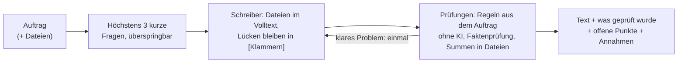

# Geef.Atelier

*[English](README.md) · **Deutsch***

**Atelier macht aus einem kurzen Auftrag einen fertigen Text** – einen Brief, eine E-Mail, einen Artikel, eine Zusammenfassung,
einen Bericht. Du sagst, was du brauchst, hängst Dateien an, wenn du welche hast, und bekommst den Text zusammen mit dem, was
geprüft wurde, was noch offen ist und was angenommen wurde. Es läuft im Browser und aus KI-Assistenten wie Claude Code (über MCP).
Grundlage ist das offene [Geef SDK](https://github.com/chr0mcom/geef).

## So funktioniert es, in einem Bild



Die laufende Anwendung erklärt sich selbst auf zwei öffentlichen Seiten. Die **Startseite** (`/`) sagt kurz, was Atelier tut,
zeigt ein erfundenes Beispiel vom Auftrag bis zum Text mit Lücken und offenen Punkten, nennt, was Atelier nicht tut, und führt jede
Zielgruppe (Privat, Verein und Schule, kleines Büro, Nutzer von KI-Assistenten, Administratoren und Entwickler) zum passenden Teil
von **How it works** (`/how-it-works`). Beide Seiten lesen die aktuellen Schalter (und die Ausnahmen einer angemeldeten Person) und
zeigen deshalb nie etwas als verfügbar, was ausgeschaltet ist (D-080, D-084).

## Für wen

| Du … | Hier anfangen |
|---|---|
| willst einen Text und nutzt den Browser | [Leitfaden: Schreiben mit Atelier](docs/12-user-guide_de.md) |
| nutzt einen KI-Assistenten (geprüft mit Claude Code) | [Leitfaden: aus einem KI-Assistenten](docs/13-ai-assistant-guide_de.md) |
| betreibst Atelier für ein Team: Konten, Schalter, die ältere Werkstatt | [Leitfaden für die Administration](docs/14-admin-guide_de.md) |
| entwickelst oder betreibst es selbst | [Leitfaden für Entwicklung und Betrieb](docs/15-developer-guide_de.md) |

## Was es um das Schreiben herum tut – und was nicht

Jeder Punkt nennt die Entscheidung, die ihn beschreibt.

- **Gibt dem Schreiber ganze Dateien.** Bis 150.000 Zeichen bekommt der Schreiber die Dateien vollständig, vorher wird nichts
  gekürzt; bis 600.000 bekommt er ein Inhaltsverzeichnis und durchsucht die Teile, auf die es ankommt. Scheint er nur Teile
  gelesen zu haben, sagt das Ergebnis es (D-069, D-070).
- **Fragt vorher statt hinterher.** Höchstens drei kurze Fragen mit Antworten zum Anklicken, nur vor dem Start, immer
  überspringbar; was es nicht fragt, wird als Annahme aufgelistet (D-068, D-071, D-072). In einer kleinen Messung (elf Aufträge einer
  Person, blind von KI-Juroren bewertet) schlug Fragen das bloße Annehmen 9 : 1 (D-068).
- **Lässt Lücken sichtbar.** Vermutungen über Fakten, die die Person nicht genannt hat, erreichen den Schreiber als „nicht
  gegeben“ markiert, und der Schreiber wird gebeten, Platzhalter zu lassen; das Ergebnis listet sie unter „Fill these in before you send the text“ (D-069,
  D-073).
- **Sagt, was geprüft wurde – und was nicht.** Auf dem Standardweg nennt „What was checked“ nur Prüfungen, die gelaufen sind, und endet mit dem Satz,
  dass sie nicht beweisen, dass der Text stimmt. Der Faktenprüfer meldet Stellen, die vielleicht nicht gestützt sind; in der
  ausgelieferten Einstellung ändert er den Text nicht (D-073).
- **Ein Ort für jede Version.** Aufträge, Versionen und Exporte (Word, PDF, Markdown) in der Web-App und über MCP (D-070, D-075).

Grenzen: Der Text kann trotzdem falsch sein; der Faktenprüfer kann etwas übersehen und meldet auch harmlose Sätze (D-075); Atelier
ist kein Chat; es lernt nicht aus früheren Texten (Lernen pausiert, D-067; Gedächtnis nicht gebaut, D-077); Scans ohne Text kann es
nicht lesen (D-076); „Extra careful“ nutzt die ältere Schleife, sucht nicht im Web und hat kein „What was checked“. Web-Recherche auf dem
Standardweg ist gebaut, aber für alle ausgeschaltet, bis ihre Messung bestanden ist (D-074, D-077). Einen fertigen Text kann man
ändern („Change something“, D-078). Ausdrücklich gewählte Werkstatt-Teams können eine eigene Websuche nutzen.

## Weiterlesen

| Dokument | Inhalt |
|---|---|
| [docs/README_de.md](docs/README_de.md) | Übersicht aller Dokumente |
| [docs/05-decisions-log_de.md](docs/05-decisions-log_de.md) | Jede Entwurfsentscheidung und Messung, zuletzt D-067 bis D-077 |
| [docs/02-architecture_de.md](docs/02-architecture_de.md) | Schichten, Datenmodell, Schutzmechanismen, Schalter |
| [docs/04-mcp-integration_de.md](docs/04-mcp-integration_de.md), [docs/09-endpoint-reference_de.md](docs/09-endpoint-reference_de.md) | MCP-Werkzeuge und HTTP-Endpunkte im Detail |

---

## Lokaler Start

```bash
# App + Postgres starten
docker compose -f docker-compose.dev.yml up --build -d

# Health-Check
curl http://localhost:8080/health   # → Healthy

# Stack stoppen
docker compose -f docker-compose.dev.yml down
```

## Auth-Setup

### Benutzer

Die App unterstützt mehrere Benutzerkonten. Der erste Admin-Account wird automatisch aus Env-Vars gesetzt und beim Start angelegt bzw. synchronisiert:

```bash
# BCrypt-Hash für ein Passwort generieren (work factor 11)
dotnet run --project tools/HashPassword -- "DeinPasswort"
# Ausgabe: $2a$11$...
```

```env
ATELIER_USER=<admin-username>
ATELIER_PASSWORD_HASH=$2a$11$...
```

Weitere Benutzer können im Admin-Panel unter `/admin/users` angelegt werden (nur für den Admin-Account sichtbar).

**Dev-Defaults** (nur für lokale Entwicklung, in `docker-compose.dev.yml`):
- Username: `admin`
- Passwort: `DevPassword!`

### MCP-Token (Claude Code CLI)

```bash
# Zufälligen Token generieren
openssl rand -hex 32
```

```env
ATELIER_MCP_TOKEN=<hex-token>
```

---

## Tests

```bash
# Benötigt laufenden Docker-Daemon (Testcontainers)
dotnet test
```

## Migration manuell ausführen

```bash
dotnet ef database update \
  --project src/Geef.Atelier.Infrastructure \
  --startup-project src/Geef.Atelier.Web
```

---

## MCP-Server

Der MCP-Server läuft unter `/mcp`. Zwei Auth-Pfade stehen parallel zur Verfügung:

### Pfad A: Statisches Bearer-Token (Claude Code CLI)

```json
{
  "mcpServers": {
    "geef-atelier": {
      "url": "https://<your-domain>/mcp",
      "transport": "streamable-http",
      "auth": {
        "type": "bearer",
        "token": "<ATELIER_MCP_TOKEN>"
      }
    }
  }
}
```

### Pfad B: OAuth 2.1 (Claude Desktop / Claude.ai Custom Connector)

URL `https://<your-domain>/mcp` im Client eintragen — der Client erkennt den `WWW-Authenticate`-Header mit der Resource-Metadata-URL und startet den OAuth-Flow automatisch (Dynamic Client Registration → Browser-Login → Consent-Seite → Token-Exchange).

Voraussetzung: Der OAuth-Client muss im Admin-Panel unter `/admin/oauth-clients` registriert sein, oder der Client registriert sich selbst per Dynamic Client Registration (`POST /oauth/register`).

### MCP-Werkzeuge

Die Auftragswerkzeuge (`submit_order`, `answer_order`, `get_order_status`, `get_order_result`, `revise_order`, `export_order`,
`cancel_order`, `list_orders`, `profile`) und, solange `Uploads:Tickets` `On` ist, `prepare_attachment`. Solange
`Mcp:LegacyTools` `true` ist (ausgeliefert), kommen die älteren Werkzeuge der Werkstatt hinzu. Hinter `Mcp:Skills` und
`Mcp:Elicitation` (beide ausgeliefert `Off`, D-088) kann der Server zusätzlich einen Skill zur Benutzung von Atelier anbieten und
seine Rückfragen als Formular des Clients stellen. Überblick:
[docs/13-ai-assistant-guide_de.md](docs/13-ai-assistant-guide_de.md) (die Werkzeugtabelle dort prüft ein Test gegen den Server);
Verträge: [docs/04-mcp-integration_de.md](docs/04-mcp-integration_de.md), [docs/09-endpoint-reference_de.md](docs/09-endpoint-reference_de.md).

---

## Die ältere Werkstatt: Crew-System

Das ist die Arbeitsweise aus der Zeit vor dem Umbau im November 2026; „Extra careful“ und die älteren Werkzeuge nutzen sie noch. Jeder Run verwendet eine konfigurierbare Crew aus Executor (schreibt den Draft) und Reviewern (bewerten den Draft). Das Standard-Template `"klassik"` reproduziert das ursprüngliche Verhalten mit zwei Reviewern in paralleler Ausführung.

**Verfügbare Evaluation-Strategien:** `Parallel` (Standard), `Sequential`, `FailFast`, `Priority`.

**System-Profile** sind im Code versioniert und read-only. **Custom-Profile** können per `ICrewService` oder MCP erstellt und in der DB gespeichert werden.

Jeder Run speichert einen vollständig eingebetteten **CrewSnapshot** in der DB — damit bleibt der Run reproduzierbar, auch wenn Profile später geändert werden.

**Modellmatrix (D-066):** Profile geben eine Rolle (`ModelSlot`) an, Crews ein Gebiet. Das System setzt jedem verwalteten Akteur beim Run-Start sein Modell aus `ModelMatrix`.

- Claude läuft immer über `claude-cli`, OpenAI über `codex-cli`.
- Verwaltete Reviewer meiden das Executor-Modell (geteilt nur mit Warnung, wenn kein anderer Kandidat nutzbar ist) und bevorzugen eine andere Familie; ein manuell gebundener Reviewer behält sein Modell und wird nur gewarnt.
- Profile auf „Manual“ behalten ihr gewähltes Modell.

Siehe [docs/08-crew-system_de.md](docs/08-crew-system_de.md).

### Crew-Verwaltung in der UI

| Seite | URL |
|-------|-----|
| Crew-Übersicht | `/crew` |
| Template-Liste | `/crew/templates` |
| Template anlegen/bearbeiten | `/crew/templates/new`, `/crew/templates/{name}` |
| Reviewer-Profile | `/crew/profiles/reviewers` |
| Executor-Profile | `/crew/profiles/executors` |
| Grounding-Provider | `/crew/profiles/grounding-providers` |
| Finalizer-Profile | `/crew/profiles/finalizers` |
| Template Studio (KI-gestützte Template-Erstellung) | `/crew/studio` |

Diese Seiten erreicht man über das Menü „Workshop“, das nur Admins sehen, solange `Ui:WorkshopForAdminsOnly` an ist (ausgeliefert); die Adressen selbst bleiben wie bisher für alle Angemeldeten offen (D-077).

Details: [docs/08-crew-system.md](docs/08-crew-system_de.md)

---

## Production-Deployment

Voraussetzungen: Traefik läuft auf dem Server, DNS der Domain zeigt auf den Server.

### Erste Einrichtung

**1. Secrets generieren:**

```bash
# BCrypt-Hash für das UI-Passwort (work factor 11)
dotnet run --project tools/HashPassword -- "DeinPasswort"

# MCP-Token (64 Hex-Zeichen)
openssl rand -hex 32

# Postgres-Passwort
openssl rand -base64 24
```

**2. `.env`-Datei anlegen** (niemals in Git committen — ist gitignored):

```env
POSTGRES_DB=geef_atelier
POSTGRES_USER=geef_atelier
POSTGRES_PASSWORD=<generiertes-passwort>

ATELIER_USER=<admin-username>
ATELIER_PASSWORD_HASH=<bcrypt-hash>
ATELIER_MCP_TOKEN=<hex-token>
ATELIER_DOMAIN=<your-domain>

LLM_OPENROUTER_API_KEY=<openrouter-api-key>

# Tavily Web Search (https://tavily.com) — optional; erforderlich für tavily-, news-search- und tavily-news-Grounding-Profile
TAVILY_API_KEY=
```

**3. Stack starten:**

```bash
docker compose up -d --build
```

Migrations laufen automatisch beim Start. Health-Check: `https://<your-domain>/health`.

### Neustart / Update

```bash
docker compose build --no-cache web && docker compose up -d web
docker compose logs -f web
```

### Wichtige URLs

| URL | Beschreibung |
|-----|--------------|
| `https://<your-domain>/` | Web-UI (Cookie-Auth) |
| `https://<your-domain>/how-it-works` | Öffentliche Erklärseite; folgt den aktuellen Schaltern |
| `https://<your-domain>/health` | Health-Check |
| `https://<your-domain>/mcp` | MCP-Endpunkt (Bearer / OAuth 2.1) |
| `https://<your-domain>/admin/users` | Benutzerverwaltung (nur Admin) |
| `https://<your-domain>/admin/oauth-clients` | OAuth-Client-Verwaltung (nur Admin) |
| `https://<your-domain>/.well-known/oauth-authorization-server` | OAuth Server Metadata |

---

## Backup & Restore

Der `postgres-backup`-Container erstellt automatisch tägliche Backups.

- **Zeitplan:** täglich 03:00 UTC
- **Retention:** 7 Tages-, 4 Wochen-, 6 Monats-Snapshots
- **Speicherort:** Docker-Volume `geef-atelier-backups`
- **Format:** `.sql.gz` (gzip-komprimiertes pg_dump)

```bash
# Backup manuell auslösen
docker compose exec postgres-backup /backup.sh

# Backups inspizieren
docker compose exec postgres-backup ls -lh /backups/last/

# Backup aus Volume kopieren
docker cp geef-atelier-postgres-backup:/backups/last/<datei>.sql.gz ./
```

### Restore

```bash
docker compose stop web
./scripts/restore-backup.sh <pfad-zur-backup-datei.sql.gz>
curl https://<your-domain>/health
```

> **Hinweis:** `scripts/restore-backup.sh` überschreibt alle bestehenden Daten. Vor dem Restore eine aktuelle Kopie sichern.

---

## Projektstruktur

```
src/
  Geef.Atelier.Core/           Domain-Entities, Interfaces — keine externen Abhängigkeiten
  Geef.Atelier.Application/    IRunService, IOAuthService, IUserAdminService u.a.
  Geef.Atelier.Infrastructure/ EF Core, Npgsql, LLM-Clients, Geef.Sdk-Provider-Impl.
  Geef.Atelier.Web/            Blazor Server, BackgroundService, Endpoints, MCP-Server
  Geef.Atelier.Mcp/            MCP-Tool-Definitionen (Class Library)
tests/
  Geef.Atelier.Tests/          xUnit + Testcontainers + bUnit
tools/
  HashPassword/                BCrypt-Hash-Generator CLI
docs/
  reports/                     Abschlussberichte je Bau-Schritt
```

## Stack

- .NET 10 / Blazor Server / Minimal API
- PostgreSQL 16 + pgvector via `Npgsql.EntityFrameworkCore.PostgreSQL`
- [Geef.Sdk 1.0.0-ci.1](https://www.nuget.org/packages/Geef.Sdk/) (prerelease)
- Docker / Traefik

---

## Geschichte des Aufbaus (historisch)

Die Liste hält fest, wie das Projekt gewachsen ist. Sie bleibt zur Nachvollziehbarkeit stehen; den aktuellen Stand beschreiben die Abschnitte oben und die Leitfäden.

**Schritt 1 ✅** Solution-Struktur, Postgres-Persistence, Health-Check, Docker-Compose.

**Schritt 2 ✅** In-memory Geef-Pipeline mit Stub-Providern — kein LLM, kein DB-Zugriff. Convergence-Loop, EventSink, alle vier Provider-Verträge implementiert und mit xUnit-Tests abgedeckt.

**Schritt 3 ✅** Echte Anthropic-API-Aufrufe — `IAnthropicClient`, `LlmExecutionStep`, zwei `LlmReviewer` (Tool Use). Polly-Resilience.

**Schritt 4 ✅** Postgres-Persistierung — `PostgresEventSink` schreibt jeden Pipeline-Run mit Iterationen, Findings, Token-Verbrauch und Event-Log in die DB.

**Schritt 5 ✅** BackgroundService-Orchestrierung — `RunOrchestratorService` pollt für Pending-Runs, setzt atomaren Claim, führt die Geef-Pipeline concurrent aus, recovert crashed Runs beim Start.

**Schritt 6 ✅** Application-Service-Layer — `IRunService` (Submit/Get/List/Cancel), `IRunRepository`, Cancellation-Watcher.

**Schritt 7 ✅** Blazor-UI — drei Pages (`/new`, `/runs`, `/runs/{id}`), SignalR-Hub mit Live-Status, 9 UI-Komponenten, bUnit- und Playwright-Tests.

**Schritt 8 ✅** Cookie-Auth — Single-User-Login, `[Authorize]` auf Pages, Login/Logout, `TestAuthenticationHandler` für E2E-Tests.

**Schritt 9+ ✅** Crew-System, Advisor-Pässe, Template Studio (mit vollständigem Edit-Flow, D-043), Domain-Templates, Grounding-Provider-CRUD, Vector-Store-RAG, PDF-Support, Cost-Tracking.

**MCP-OAuth ✅** Self-hosted OAuth 2.1 Authorization Server (RFC 8414/7591/7636/7009/8252) — Authorization-Code-Flow mit Pflicht-PKCE/S256, Opaque Tokens, Refresh-Rotation, Reuse-Detection.

**Multi-User ✅** DB-basierte Benutzerverwaltung mit BCrypt, Admin-UI unter `/admin/users`, Startup-Seeding des Admin-Accounts aus Env-Vars.

**Run-User-Isolation ✅** Jeder Nutzer sieht nur seine eigenen Runs; Admin-Override per expliziten Umschaltern. MCP-Runs werden dem autorisierenden OAuth-Nutzer zugeordnet, Claude-Code-CLI-Runs (statisches Token) dem Admin (D-042).

**Finalizer-Pipeline ✅** 5. Profil-Typ — FinalizerProfile mit vier Typen (FileExport, MetadataEnrich, ExternalSink, Transform). 17 System-Profile. RunArtifact-Entity (File mit Download, Url, Status). Download-Endpunkt mit Owner-Check. FinalizerPicker + RunFinalizersOnMaxAttempts im CrewTemplateEditor. RunDetail-Artefakt-Tabelle. Studio-Integration. 2 neue MCP-Tools (D-044, 19. Mai 2026).

**Run-Resume ✅** Einen fehlgeschlagenen oder abgebrochenen Run dort fortsetzen, wo er aufgehört hat — Seed-Modus (weiter mit letztem Draft) oder Clean-Modus (neuer Start mit gleichem Briefing). „Fortsetzen"-Button in RunDetail, ResumeRunDialog mit MaxIterations-Override. ParentRunId-Link in RunDetail (PR #18, 19. Mai 2026).

**Grounding-Refinement ✅** Optionaler KI-Filter-Pass nach jedem Grounding-Provider-Fetch — Filter-Modus (pro Quelle keep/drop mit Begründung) und Synthesize-Modus (alle Quellen zu einem kohärenten Text mit `[n]`-Zitaten zusammenfassen). Pro Provider via `LlmBinding` konfigurierbar (D-049/D-050, PR #22, 20. Mai 2026).

**Grounding-Typen ✅** Drei neue Grounding-Provider-Typen neben den bestehenden `tavily` und `vector-store`: `static-context` (kuratierter Fixtext — Style-Guides, Glossare, Markenstimme), `url-fetch` (gezieltes URL-Fetching mit SSRF-Guard, der alle privaten/Cloud-Metadata-IPs blockiert) und `news-search` (Tavily-Newssuche mit Datumsfilter). Neues System-Profil `tavily-news`. Dashboard-Cost-Aggregation umfasst jetzt auch Grounding-Refiner-Kosten (D-051, PR #23, 20. Mai 2026).

**Tool-System ✅** Zentraler `ToolDefinition`-Katalog + agentic Tool-Use (Pull, `IToolUseRunner`) für Executor/Reviewer/Advisor, Grounding auf dieselben Tools neu aufgebaut (Push), Provider-Capability-Detection, `/tools`-CRUD + `ToolPicker`, `ToolInvocationsBlock`-Audit, Auto-Crew-Tool-Binding und ein MCP-Client (`/mcp-servers` Discovery/Import). Siehe [docs/10-tool-system_de.md](docs/10-tool-system_de.md) (D-060).

**Spezialisierungs-Packs ✅** Generische Akteure (Rollen-Prompt + `{specialization}`-Slot) + wiederverwendbare gescopte `SpecializationPack`s, pro Crew gebunden. Effektiver Prompt zur Snapshot-Bauzeit komponiert (CrewSnapshot v3 + Provenienz), in der Audit-UI sichtbar. Die sechs domänen-spezialisierten System-Reviewer wurden zu zwei generischen Rollen + sechs DomainScoped-Packs. `/packs`-CRUD, Scope-Durchsetzung, Composer-Integration (`pack_names`/`packs` + Pack-Katalog-Grounding), Lebenszyklus (Cascade-Delete, Promote/Demote/Clone mit LLM-Generalitäts-Review, Auto-GC). Siehe [docs/11-specialization-packs_de.md](docs/11-specialization-packs_de.md) (D-061).

**Modellmatrix ✅** Modellwahl nach Rolle (`ModelSlot`) und Crew-Gebiet aus einer recherchierten `ModelMatrix`; Claude/OpenAI nur über den Abo-cli-proxy; Zuweisung beim Snapshot-Bau mit Live-Verfügbarkeit, Executor-Ausschluss, Reviewern aus anderer Familie, Reviewer-Ring und Bezahlt-Deckel; der Composer wählt `model_slot`; Migration Step46 hat alle bestehenden eigenen Profile neu klassifiziert; Codex-Katalog des cli-proxy aus `models_cache.json` (D-066, 2026-11-22).

**Etappe 1: Aufträge und Direktweg ✅** Der Auftrag ist die Einheit, die die Person sieht (`/start`, `/work`, `/orders/{id}`); Dateien werden einzeln mit Quittung hochgeladen und als Quellen gehalten; der Direktweg schreibt mit den Dateien im Volltext (ab 150.000 Zeichen mit Karte, ab 600.000 mit Seitenauswahl), prüft das Ergebnis ohne Modell und korrigiert einmal; MCP-Werkzeuge `submit_order`, `get_order_status`, `get_order_result`; Migration Step48 verknüpft bestehende Läufe mit Aufträgen (D-069, D-070, 2026-11-24).

**Etappen 2–6 ✅, Umbau abgeschlossen (D-077)** Rückfragen vor dem Lauf (D-071/D-072), ehrliches Schreiben mit Prüfungen (D-073), Recherche (D-074, ausgeschaltet), Ändern eines Ergebnisses (D-075, ausgeschaltet) und der vollständige MCP-Auftragsvertrag, Dateien über ein Upload-Ticket (D-076). Etappe 8a: Die Werkstatt-Einstiege sehen nur Admins (`Ui:WorkshopForAdminsOnly`). Nicht gebaut, jeweils mit Auslöser: Etappe 1b (entschärfte Schleife und erster Rückbau), Etappe 7 (Gedächtnis), der Rückbau aus Etappe 8 und Etappe 9 (D-077).

Aktuell: **über 1800 Tests** (grün; vorbestehende Testcontainers-/E2E-Umgebungs-Flakes ausgenommen).

Vollständiger Scope: [docs/01-vision-and-scope.md](docs/01-vision-and-scope_de.md)
