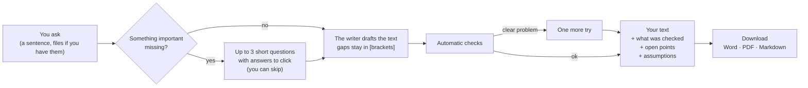

# Guide: writing with Atelier

*[Deutsch](12-user-guide_de.md) · **English***

*Last updated: 2026-11-26 (after review: web search only on the standard way, storage, wording)*

This guide is for everyone who uses Atelier in the web browser. You need no technical knowledge. The page **How it works**
(`/how-it-works`, also open without signing in) shows the same in short, with the features that are switched on for you right
now.

## What Atelier does

You say what you need written. Atelier writes it, checks what it can and tells you what is still open. You decide what to send.

The questions step and some other features can be switched off by the administrator. The page How it works always shows what
is on for you.

## Step by step

### 1. Ask

Open **New**. Write in your own words what you need, for example: "Write a short, friendly email to a customer about a two-week
delivery delay." You do not need special phrasing.

**Files** (optional): add PDF, Word (.docx), text or Markdown files by dropping, pasting or choosing them. After each file you see
a short receipt: what Atelier read, with pages, characters and how well it could be read.

- Up to 10 files per request, each up to 25 MB (default settings).
- Up to 150,000 characters in all, the writer gets the files completely. Up to 600,000 characters it gets a table of contents and
  searches the parts that matter. Above that you choose the pages of a PDF to use; Start stays locked until it fits.
- Scanned pages (photos of paper) cannot be read.
- You cannot add files to a request later. Add everything before you press Start.

**Extra careful** is a box below the files. It uses an older way of working with several review rounds. It takes longer, it does
not look things up on the web, and its result does not show "What was checked". For most texts, leave it off.

### 2. Answer a few questions (or skip them)

If something important is missing, Atelier asks up to three short questions before it starts, each with answers to click. You can
also write your own answer where it is offered, press **You decide**, or press **Just start**. What Atelier still has to guess is
written down as an assumption, and you can correct the assumptions it shows you.

Atelier asks only before it starts, never while it writes. If nothing important is missing, it starts at once.

### 3. Wait

This can take from less than a minute to several minutes. You can leave the page; your text waits under **My work**. You can stop a request with **Stop**.

### 4. Read the result

The page of your request shows, from top to bottom:

| Part | What it means |
|---|---|
| **Your text** | The finished text. Gaps the writer could not fill stand in [square brackets]. |
| **What was checked** | Only the checks that really ran (see below). Always ends with: "These checks look for the problems named here. They do not prove that everything in the text is right." |
| **Open points** | "Fill these in before you send the text" (the gaps), checks that were not met, passages that may not be backed by what you gave, problems found in your files. |
| **Assumptions** | What you did not say and what was assumed. |
| **From your files** | Which files were used and how. |
| **How it was made** | Your request, the steps and the versions. |

The state at the top says **Ready** or **Ready – please check** (there are open points you should look at).

### 5. Download or change

Download the text as **Word, PDF or Markdown**. The file holds only the text; the open points stay on the page.

**Change something** (when it is switched on for you): below a finished text, say in your own words what to change. Atelier writes
a new version and keeps the earlier ones; **Show changes** shows the difference. The writer is asked to make only that change, but
nothing checks that nothing else changed, so read the new version. While this feature is off, the button does not appear.

## What the checks mean

| Line in "What was checked" | What happened |
|---|---|
| Checked automatically: the text … | Checked without AI. A few basics always: the text is not empty and starts directly. Length, language, gaps, lists or headings and words to use or avoid only when your request asked for them. |
| Facts in the text were compared with … | Another AI compared the facts in the text with your request, your answers and your files and lists passages it could not find there. In the current default setting it **does not change the text**. It can miss things, and it often points at harmless sentences too, such as a closing line or a signature. With very long files it compares the text only with your request and answers, and the line says so. |
| Totals in your files … | Sums in your files were added up again without AI. If one does not match, you see both figures. |
| Changed after the check | What was changed because of a check. |

## About me

Under **About me** (your menu at the top right) you can save your name, what you do, your organisation, how readers are addressed,
your language, how you sign off, what never to do and other notes. Atelier uses it in every text, so you do not have to repeat it.
Only you can change it.

## Where your words go

- Your request, your answers, your About me details and your files go to the AI services this Atelier uses to write and check the
  text.
- Looking things up on the web, when it is switched on, happens only on the standard way and only when you add no files. The
  search gets only short topics taken from your request; topics with words from your About me details are held back (this compares
  words, so it can miss a word in another language). "Extra careful" never searches the web. Teams that administrators set up
  in the workshop can have their own web search.
- Only you and the administrators of this Atelier can see your requests.
- Atelier keeps your request, your text and what it read from your files until you delete the request under My work. Deleting it
  also deletes the files that no other request uses. The original file is removed about 30 days after the last request that used it
  finished; the text read from it stays with the request.

## What Atelier does around the writing

- The writer gets your whole file (up to the limit above); nothing is shortened first. If it seems to have read only parts, the
  result says so.
- It asks before it starts, and it is built to ask only what changes the result.
- It is built to show what it did not know: the writer is asked to leave gaps, and guesses are listed.
- It says what was checked and what was not, and never claims the text is right.
- It knows your About me details.
- Every request, version and download stays under My work.

What it does **not** do: it can still be wrong; it is not a chat; it does not learn from your earlier texts (only About me carries
over); it cannot read scans (photos of paper).

## When something goes wrong

- **"No text – something went wrong"**: press **Try again** or **Start again with the same request**; your request and files are filled in again.
- **A file cannot be used**: the receipt says why. Try another version of the file (for example a PDF with text instead of a scan).
- **Start stays grey**: the line next to it says what is missing (a request, a file still loading, too many characters).

More: the page How it works in the app (`/how-it-works`), the [guide for AI assistants](13-ai-assistant-guide.md) and the
[guide for administrators](14-admin-guide.md).
