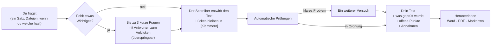

# Leitfaden: Schreiben mit Atelier

***Deutsch** · [English](12-user-guide.md)*

*Letzte Aktualisierung: 2026-11-27 („Extra careful“ entfernt, ein Weg zu schreiben, auch für lange Texte, zweiter Zusatz zu D-087; D-091: Stufe 8d, ältere Aufträge; davor „Tell Atelier once“ mit seiner Zusage, Zusatz zu D-083; Nachschlagen im Web für alle eingeschaltet, Zusatz zu D-074)*

Dieser Leitfaden ist für alle, die Atelier im Browser nutzen. Technisches Wissen ist nicht nötig. Die Seite **How it works**
(`/how-it-works`, auch ohne Anmeldung erreichbar) zeigt dasselbe in kurz, zusammen mit den Funktionen, die gerade für dich
eingeschaltet sind. Die Oberfläche selbst ist englisch (Entscheidung D-062); die Namen der Knöpfe stehen hier deshalb auf Englisch.

## Was Atelier tut

Du sagst, was du geschrieben brauchst. Atelier schreibt es, prüft, was es prüfen kann, und sagt dir, was noch offen ist. Was du
verschickst, entscheidest du.

Den Schritt mit den Fragen und einige andere Funktionen kann die Administration ausschalten. Die Seite How it works zeigt immer,
was für dich eingeschaltet ist.

## Schritt für Schritt

### 1. Fragen

Öffne **New**. Schreib in deinen eigenen Worten, was du brauchst, zum Beispiel: „Schreib eine kurze, freundliche E-Mail an einen
Kunden wegen zwei Wochen Lieferverzug.“ Besondere Formulierungen sind nicht nötig.

**Dateien** (freiwillig): PDF, Word (.docx), Text oder Markdown hineinziehen, einfügen oder auswählen. Nach jeder Datei siehst du
eine kurze Quittung: was Atelier gelesen hat, mit Seiten, Zeichen und wie gut sie lesbar war.

- Bis zu 10 Dateien je Auftrag, je bis 25 MB (Standardeinstellung).
- Bis 150.000 Zeichen zusammen bekommt der Schreiber die Dateien vollständig. Bis 600.000 Zeichen bekommt er ein
  Inhaltsverzeichnis und durchsucht die Teile, auf die es ankommt. Darüber wählst du die Seiten eines PDFs; „Start“ bleibt gesperrt,
  bis es passt.
- Eingescannte Seiten (Fotos von Papier) kann Atelier nicht lesen.
- Dateien lassen sich später nicht nachreichen. Füg alles hinzu, bevor du auf „Start“ drückst.

### 2. Ein paar Fragen beantworten (oder überspringen)

Fehlt etwas Wichtiges, stellt Atelier vor dem Start bis zu drei kurze Fragen, jede mit Antworten zum Anklicken. Du kannst, wo es
angeboten wird, auch selbst antworten, **You decide** drücken oder **Just start**. Was Atelier dann noch raten muss, wird als
Annahme notiert; die gezeigten Annahmen kannst du korrigieren. Überspringst du eine dieser Fragen (oder drückst du **You
decide**), wird der Schreiber angewiesen, dazu nicht für dich zu- oder abzusagen, und das Ergebnis nennt die Frage unter „Open
points“. Das gilt nicht für Dinge, nach denen Atelier nicht gefragt hat, und nicht für seine Annahmen; startest du, während Atelier
den Auftrag noch liest, bekommt der Schreiber nur einen allgemeinen Hinweis auf dieselbe Regel. Prüfe den Text, bevor du ihn
verschickst.

Atelier fragt nur vor dem Start, nie während des Schreibens. Fehlt nichts Wichtiges, beginnt es sofort.

### 3. Warten

Das kann zwischen weniger als einer Minute und einigen Minuten dauern. Du kannst die Seite verlassen; dein Text wartet unter **My work**. Mit **Stop** hältst
du einen Auftrag an.

### 4. Das Ergebnis lesen

Die Seite deines Auftrags zeigt von oben nach unten:

| Teil | Bedeutung |
|---|---|
| **Your text** | Der fertige Text. Lücken, die der Schreiber nicht füllen konnte, stehen in [eckigen Klammern]. |
| **What was checked** | Nur die Prüfungen, die wirklich gelaufen sind (siehe unten). Endet immer mit: „These checks look for the problems named here. They do not prove that everything in the text is right.“ (Diese Prüfungen suchen die genannten Probleme. Sie beweisen nicht, dass alles im Text stimmt.) |
| **Open points** | „Fill these in before you send the text“ (die Lücken), nicht erfüllte Prüfungen, Stellen, die das von dir Gegebene vielleicht nicht stützt, Probleme in deinen Dateien. |
| **Assumptions** | Was du nicht gesagt hast und was angenommen wurde. |
| **Looked up** | Nur wenn Atelier für diesen Auftrag etwas im Web nachgeschlagen hat: die gesendeten Suchwörter (nur du siehst sie) und Stellen, wörtlich von den Seiten übernommen, mit Seite und Tag. Sie zeigen, was die Seiten sagen, nicht, dass es stimmt. Konnte nichts nachgeschlagen werden, sagt ein Satz, warum (zum Beispiel, weil die Tagesgrenze erreicht war). |
| **From your files** | Welche Dateien wie genutzt wurden. |
| **How it was made** | Dein Auftrag, die Schritte und die Versionen. |

Oben steht **Ready** oder **Ready – please check** (es gibt offene Punkte, die du ansehen solltest).

### 5. Herunterladen oder ändern

Lade den Text als **Word, PDF oder Markdown** herunter. Die Datei enthält nur den Text; die offenen Punkte bleiben auf der Seite.

**Change something** (wenn es für dich eingeschaltet ist): Unter einem fertigen Text sagst du in eigenen Worten, was geändert
werden soll. Atelier schreibt eine neue Version und behält die früheren; **Show changes** zeigt den Unterschied. Der Schreiber wird
gebeten, nur diese Änderung zu machen, aber nichts prüft, dass sonst nichts geändert wurde – lies die neue Version also. Ist sie deutlich länger als die vorige, steht über
dem Text ein Hinweis, die neuen Stellen zu prüfen. Solange
die Funktion aus ist, erscheint der Knopf nicht.

## Was die Prüfungen bedeuten

| Zeile in „What was checked“ | Was passiert ist |
|---|---|
| Checked automatically: the text … | Ohne KI geprüft. Ein paar Grundlagen immer: Der Text ist nicht leer und beginnt mit dem Text selbst, nicht mit einer Bemerkung an den Leser. Länge, Sprache, Lücken, Listen oder Überschriften und Wörter, die vorkommen oder fehlen sollen, nur, wenn dein Auftrag es verlangt. |
| Facts in the text were compared with … | Eine weitere KI hat die Fakten im Text mit deinem Auftrag, deinen Antworten und deinen Dateien verglichen und listet Stellen, die sie dort nicht fand. In der aktuellen Standardeinstellung **ändert sie den Text nicht**. Sie kann etwas übersehen und meldet oft auch harmlose Sätze, etwa eine Schlussformel oder eine Unterschrift. Bei sehr langen Dateien vergleicht sie den Text nur mit deinem Auftrag und deinen Antworten, und die Zeile sagt das. |
| Totals in your files … | Summen in deinen Dateien wurden ohne KI nachgerechnet. Passt eine nicht, siehst du beide Zahlen. |
| Changed after the check | Was wegen einer Prüfung geändert wurde. |

## About me

Unter **About me** (dein Menü oben rechts) kannst du deinen Namen, deine Tätigkeit, deine Organisation, die Anrede der Leser,
deine Sprache, deinen Gruß, was nie passieren soll, und weitere Hinweise speichern. Atelier nutzt das in jedem Text, du musst es
nicht wiederholen. Nur du kannst es ändern.

**Einmal sagen („Tell Atelier once“).** Musste ein Text deinen Namen, deinen Gruß, die Anrede der Leser oder deine Sprache raten
oder offen lassen, und steht dazu noch nichts unter About me, zeigt das Ergebnis dafür ein Feld mit **Save**. Was du dort
speicherst, kommt in About me; wurde das Feld inzwischen unter About me ausgefüllt, wird nichts überschrieben, und das Ergebnis sagt
„Already saved under About me“. Ab deinem nächsten Auftrag nimmt Atelier es aus About me, statt es zu raten oder danach zu
fragen, und der Schreiber bekommt es bei jedem neuen Auftrag (daher die Überschrift „Tell Atelier once – your next requests get it from About me“, sinngemäß: Deine
nächsten Aufträge bekommen es aus About me). Der Text, den du gerade siehst, behält die Angaben, mit denen er entstand, und ebenso
jede Änderung, um die du mit „Change something“ bittest – auch eine Angabe, die du inzwischen unter About me gelöscht hast. Soll der
neue Wert in diesen Text, schreib ihn in deine Änderung. Das Ergebnis sagt außerdem, was der Schreiber mit diesem Auftrag aus About
me bekam („With this request the writer got from About me: …“). Ändern oder löschen kannst du es unter About me; das gilt für deine
nächsten Aufträge. Ob der Schreiber es wirklich verwendet, etwa deinen Gruß wörtlich, hängt vom Text ab: Prüf das Ergebnis wie immer.

## Wohin deine Worte gehen

- Dein Auftrag, deine Antworten, deine About-me-Angaben und deine Dateien gehen an die KI-Dienste, die dieses Atelier zum
  Schreiben und Prüfen nutzt.
- Atelier kann im Web nachschlagen, aber nur, wenn du keine Dateien anhängst. Dann bekommt ein
  Suchdienst einige kurze Suchwörter aus deinem Auftrag. Atelier versucht, Mailadressen, Telefonnummern, Kontonummern und Straßenanschriften wegzulassen, die es erkennt. Es erkennt
  nicht jede Schreibweise, und Namen oder andere persönliche Angaben aus deinem Auftrag können in den Suchwörtern landen. Deine
  Antworten und Dateien werden nie gesendet. Wörter aus deinen About-me-Angaben werden zurückgehalten, außer du hast sie auch in
  den Auftrag geschrieben; eine übersetzte oder umformulierte Angabe kann aber durchrutschen. Das Ergebnis zeigt, welche
  Suchwörter gesendet wurden. Eine Änderung eines fertigen Textes nutzt, was beim ersten Mal nachgeschlagen wurde, und sucht nicht neu. Es
  gibt eine Tagesgrenze; ist sie erreicht, wird der Text ohne Nachschlagen geschrieben, und das Ergebnis sagt es.
- Nur du und die Administration dieses Ateliers sehen deine Aufträge.
- Atelier behält deinen Auftrag, deinen Text und das aus deinen Dateien Gelesene, bis du den Auftrag unter My work löschst. Dabei
  werden auch die Dateien gelöscht, die kein anderer Auftrag nutzt. Die Originaldatei wird etwa 30 Tage nach dem Ende des letzten
  Auftrags entfernt, der sie nutzte; der daraus gelesene Text bleibt beim Auftrag.

## Frühere Versionen von Atelier

Frühere Versionen hatten andere Arbeitsweisen und ein Kästchen **Extra careful**. Beides ist weg: Atelier schreibt jeden Text,
auch lange, auf demselben Weg. Aufträge von vor dem Aufräumen der Datenbank gibt es nicht mehr.

## Was Atelier um das Schreiben herum tut

- Der Schreiber bekommt deine ganze Datei (bis zur Grenze oben); vorher wird nichts gekürzt. Scheint er nur Teile gelesen zu
  haben, sagt das Ergebnis es.
- Es fragt vor dem Start und ist darauf gebaut, nur zu fragen, was das Ergebnis ändert.
- Es ist darauf gebaut zu zeigen, was es nicht wusste: Der Schreiber wird gebeten, Lücken zu lassen, und Vermutungen werden
  aufgelistet.
- Es sagt, was geprüft wurde und was nicht, und behauptet nie, dass der Text stimmt.
- Es kennt deine About-me-Angaben.
- Jeder Auftrag, jede Version und jeder Download bleibt unter My work.

Was es **nicht** tut: Es kann sich trotzdem irren; es ist kein Chat; es lernt nicht aus deinen früheren Texten (nur About me
bleibt); es kann keine Scans (Fotos von Papier) lesen.

## Wenn etwas schiefgeht

- **„No text – something went wrong“**: **Try again** oder **Start again with the same request** drücken; Auftrag und Dateien
  werden wieder eingetragen.
- **Eine Datei ist nicht nutzbar**: Die Quittung sagt, warum. Versuch eine andere Fassung (zum Beispiel ein PDF mit Text statt
  eines Scans).
- **„Start“ bleibt grau**: Die Zeile daneben sagt, was fehlt (ein Auftrag, eine Datei, die noch lädt, zu viele Zeichen).

Mehr: die Seite How it works in der App (`/how-it-works`), der [Leitfaden für KI-Assistenten](13-ai-assistant-guide_de.md) und der
[Leitfaden für die Administration](14-admin-guide_de.md).
