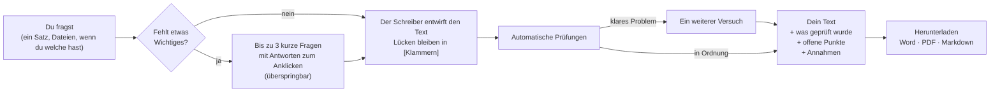

# Leitfaden: Schreiben mit Atelier

***Deutsch** · [English](12-user-guide.md)*

*Letzte Aktualisierung: 2026-11-26*

Dieser Leitfaden ist für alle, die Atelier im Browser nutzen. Technisches Wissen ist nicht nötig. Die Seite **How it works**
(`/how-it-works`, auch ohne Anmeldung erreichbar) zeigt dasselbe in kurz, zusammen mit den Funktionen, die gerade für dich
eingeschaltet sind. Die Oberfläche selbst ist englisch (Entscheidung D-062); die Namen der Knöpfe stehen hier deshalb auf Englisch.

## Was Atelier tut

Du sagst, was du geschrieben brauchst. Atelier schreibt es, prüft, was es prüfen kann, und sagt dir, was noch offen ist. Was du
verschickst, entscheidest du.

Den Schritt mit den Fragen und einige andere Funktionen kann die Administration ausschalten. Die Seite How it works zeigt immer,
was für dich eingeschaltet ist.

## Schritt für Schritt

### 1. Fragen

Öffne **New**. Schreib in deinen eigenen Worten, was du brauchst, zum Beispiel: „Schreib eine kurze, freundliche E-Mail an einen
Kunden wegen zwei Wochen Lieferverzug.“ Besondere Formulierungen sind nicht nötig.

**Dateien** (freiwillig): PDF, Word (.docx), Text oder Markdown hineinziehen, einfügen oder auswählen. Nach jeder Datei siehst du,
was Atelier gelesen hat: Seiten, Zeichen und wie gut sie lesbar war.

- Bis zu 10 Dateien je Auftrag, je bis 25 MB (Standardeinstellung).
- Bis 150.000 Zeichen zusammen bekommt der Schreiber die Dateien vollständig. Bis 600.000 Zeichen bekommt er ein
  Inhaltsverzeichnis und liest die Teile, auf die es ankommt. Darüber wählst du die Seiten eines PDFs; „Start“ bleibt gesperrt,
  bis es passt.
- Eingescannte Seiten ohne Textebene kann Atelier nicht lesen.
- Dateien lassen sich später nicht nachreichen. Füg alles hinzu, bevor du auf „Start“ drückst.

**Extra careful** ist ein Kästchen unter den Dateien. Es nutzt eine ältere Arbeitsweise mit mehreren Prüfrunden. Es dauert länger,
und sein Ergebnis zeigt kein „What was checked“.

### 2. Ein paar Fragen beantworten (oder überspringen)

Fehlt etwas Wichtiges, stellt Atelier vor dem Start bis zu drei kurze Fragen, jede mit Antworten zum Anklicken. Du kannst, wo es
angeboten wird, auch selbst antworten, **You decide** drücken oder **Just start**. Was Atelier dann noch raten muss, wird als
Annahme notiert; die gezeigten Annahmen kannst du korrigieren.

Atelier fragt nur vor dem Start, nie während des Schreibens. Fehlt nichts Wichtiges, beginnt es sofort.

### 3. Warten

Das Schreiben kann einige Minuten dauern. Du kannst die Seite verlassen; dein Text wartet unter **My work**. Mit **Stop** hältst
du einen Auftrag an.

### 4. Das Ergebnis lesen

Die Auftragsseite zeigt von oben nach unten:

| Teil | Bedeutung |
|---|---|
| **Your text** | Der fertige Text. Lücken, die der Schreiber nicht füllen konnte, stehen in [eckigen Klammern]. |
| **What was checked** | Nur die Prüfungen, die wirklich gelaufen sind (siehe unten). Endet immer mit: „These checks look for the problems named here. They do not prove that everything in the text is right.“ (Diese Prüfungen suchen die genannten Probleme. Sie beweisen nicht, dass alles im Text stimmt.) |
| **Open points** | „Fill these in before you send the text“ (die Lücken), nicht erfüllte Prüfungen, Stellen, die das von dir Gegebene vielleicht nicht stützt, Probleme in deinen Dateien. |
| **Assumptions** | Was du nicht gesagt hast und was angenommen wurde. |
| **From your files** | Welche Dateien wie genutzt wurden. |
| **How it was made** | Dein Auftrag, die Schritte und die Versionen. |

Oben steht **Ready** oder **Ready – please check** (es gibt offene Punkte, die du ansehen solltest).

### 5. Herunterladen oder ändern

Lade den Text als **Word, PDF oder Markdown** herunter. Die Datei enthält nur den Text; die offenen Punkte bleiben auf der Seite.

**Change something** (wenn es für dich eingeschaltet ist): Unter einem fertigen Text sagst du in eigenen Worten, was geändert
werden soll. Atelier schreibt eine neue Version und behält die früheren; **Show changes** zeigt den Unterschied. Der Schreiber wird
gebeten, nur diese Änderung zu machen, aber nichts prüft, dass sonst nichts geändert wurde – lies die neue Version also. Solange
die Funktion aus ist, erscheint der Knopf nicht.

## Was die Prüfungen bedeuten

| Zeile in „What was checked“ | Was passiert ist |
|---|---|
| Checked automatically: the text … | Regeln aus deinem Auftrag, ohne KI geprüft: Länge, Sprache, keine Lücken, keine Listen oder Überschriften, Wörter, die vorkommen oder fehlen sollen. Nur, was dein Auftrag verlangt. |
| Facts in the text were compared with … | Eine weitere KI hat die Fakten im Text mit deinem Auftrag, deinen Antworten und deinen Dateien verglichen und listet Stellen, die sie dort nicht fand. In der aktuellen Standardeinstellung **ändert sie den Text nicht**. Sie kann etwas übersehen und auch harmlose Sätze wie einen Gruß melden. |
| Totals in your files … | Summen in deinen Dateien wurden ohne KI nachgerechnet. Passt eine nicht, siehst du beide Zahlen. |
| Changed after the check | Was wegen einer Prüfung geändert wurde. |

## About me

Unter **About me** (dein Menü oben rechts) kannst du deinen Namen, deine Tätigkeit, deine Organisation, die Anrede der Leser,
deine Sprache, deinen Gruß, was nie passieren soll, und weitere Hinweise speichern. Atelier nutzt das in jedem Text, du musst es
nicht wiederholen. Nur du kannst es ändern.

## Wohin deine Worte gehen

- Dein Auftrag, deine Antworten, deine About-me-Angaben und deine Dateien gehen an die KI-Modelle, die den Text schreiben und
  prüfen.
- Eine Websuche bekommt, wenn sie eingeschaltet ist, nur kurze Suchthemen aus deinem Auftrag, nie deine Dateien, Antworten oder
  About-me-Angaben, und sie läuft nie, wenn du Dateien anhängst.
- Nur du und die Administration dieses Ateliers sehen deine Aufträge.

## Warum nicht einfach einen Chatbot fragen?

Ein Chatbot kann auch einen guten Text schreiben. Atelier kommt hinzu:

- Es liest deine ganze Datei statt eines Ausschnitts (bis zur Grenze oben).
- Es fragt vor dem Start, und nur, was das Ergebnis ändert.
- Es sagt, was es nicht wusste: Lücken bleiben sichtbar, Vermutungen werden aufgelistet.
- Es sagt, was geprüft wurde und was nicht, und behauptet nie, dass der Text stimmt.
- Es kennt deine About-me-Angaben.
- Jeder Auftrag, jede Version und jeder Download bleibt unter My work.

Was es **nicht** tut: Es kann sich trotzdem irren; es ist kein Chat; es lernt nicht aus deinen früheren Texten (nur About me
bleibt); es kann keine Scans lesen.

## Wenn etwas schiefgeht

- **„No text – something went wrong“**: **Try again** oder **Start again with the same request** drücken; Auftrag und Dateien
  werden wieder eingetragen.
- **Eine Datei ist nicht nutzbar**: Die Quittung sagt, warum. Versuch eine andere Fassung (zum Beispiel ein PDF mit Text statt
  eines Scans).
- **„Start“ bleibt grau**: Die Zeile daneben sagt, was fehlt (ein Auftrag, eine Datei, die noch lädt, zu viele Zeichen).

Mehr: die Seite How it works in der App (`/how-it-works`), der [Leitfaden für KI-Assistenten](13-ai-assistant-guide_de.md) und der
[Leitfaden für die Administration](14-admin-guide_de.md).
