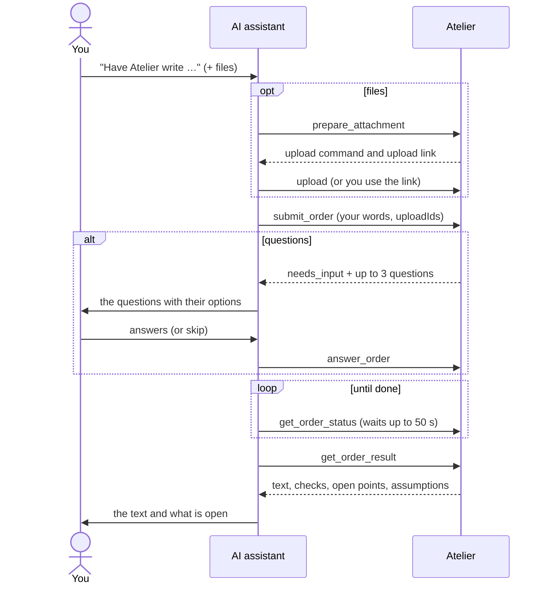

# Guide: using Atelier from an AI assistant

*[Deutsch](13-ai-assistant-guide_de.md) · **English***

*Last updated: 2026-11-26 (`profile` saves four About me details, `aboutMeMissing`/`fromAboutMe`, D-083; before that after review: what is tested, OAuth clients, web search)*

This guide is for people who want to use Atelier from an AI assistant such as Claude Code.
Assistants connect through **MCP** (Model Context Protocol), a common way for assistants to use outside tools. The technical
contract of every tool is in [04-mcp-integration.md](04-mcp-integration.md) and [09-endpoint-reference.md](09-endpoint-reference.md).

## What you get

You ask your assistant in normal words, for example "Have Atelier write a short note for the notice board." The assistant:

1. passes your request on **word for word** (the server instructions tell it not to rewrite, summarise or translate it),
2. uploads your files, if you give it any,
3. asks you Atelier's questions (at most three, with answer options; skipping is fine),
4. waits for the text,
5. shows you the text **together with** what was checked, the open points and the assumptions.

The difference to letting the assistant write the text itself: Atelier reads your files completely, leaves gaps visible instead of
filling them, and returns a fixed account of what was checked and what not. The server instructions tell the assistant not to say
more was checked than Atelier says and not to fill in gaps itself. Whether an assistant follows these instructions depends on the
assistant; the full result is always on the order page under **My work** in the web app.

## Connecting

The address is the Atelier address followed by `/mcp`, for example `https://atelier.example/mcp`. The page How it works in the app
shows the exact address of your Atelier.

**What is tested:** Claude Code, also through a connection set up in claude.ai, with a complete order including a file and a
question. Using Atelier from the claude.ai chat window itself and from Claude Desktop has not been tested.

- **Claude Code:** `claude mcp add --transport http atelier https://atelier.example/mcp` and sign in when asked. Administrators can
  also use a fixed key (bearer token); orders placed with it belong to the account set for that key.
- **Adding a connector in claude.ai:** add a custom connector with this address. The assistant opens the Atelier sign-in page;
  sign in and allow access (OAuth). From then on it acts as you. If the sign-in page does not open, ask your administrator.
- **OAuth clients:** every signed-in person can register an assistant under **OAuth clients** in the menu; only administrators can
  delete one.
- **See and remove** your connected assistants under **Connected clients** in your menu.

## The tools

The list below is what the server offers while the upload ticket is switched on (`Uploads:Tickets = On`) and the older tools are
switched off. A test compares this table with the tool catalogue of the server, so it cannot silently go out of date.

<!-- tools:start -->
| Tool | What it is for |
|---|---|
| `prepare_attachment` | Prepares the upload of one file: a one-time upload command (valid 15 minutes) and an upload page (24 hours, after signing in). Only while `Uploads:Tickets` is `On`. |
| `submit_order` | Places an order with the person's request word for word, optional `uploadIds` and `extraCareful`. |
| `answer_order` | Sends the answers to the questions (or `skip=true`). |
| `get_order_status` | Waits up to 50 seconds for a change; `done` says when the result is ready. |
| `get_order_result` | The text with `checks`, open points, assumptions and, if research ran, `lookedUp`. |
| `revise_order` | Asks for a change in the person's words and writes a new version. Answers "Changing a text is not available yet." while changing is off for the person. |
| `export_order` | The text as a Markdown, Word or PDF file (the same file as the web download). |
| `cancel_order` | Stops an order. |
| `list_orders` | The person's recent orders. |
| `profile` | Shows the About me details. Saves the name, sign-off, form of address and language when the person asks, only into empty fields (read only while `Orders:TellOnce` is `Off`). |
<!-- tools:end -->

While `Mcp:LegacyTools` is `true` (shipped), the older tools of the workshop are offered as well (for example `submit_request`,
`get_run_status`, `list_crew_templates`); five of them name their successor in their description. Without the upload ticket,
files go as Base64 in `attachments`, which only works for small files.

## Files

- With the upload ticket on, the assistant calls `prepare_attachment` for each file. If it can run shell commands, it uploads the
  file with the returned `curl` command; otherwise it gives you the upload link and waits until you say it is done. The file
  arrives byte for byte.
- If a file is refused, the assistant should tell you the reason word for word and not try the same file again.
- PDF, Word, Markdown and text, up to 25 MB. A file too long to be used completely is refused on this way; start the order in the
  web app and choose pages there.
- Files cannot be added to an order later.
- Atelier never sends your files to a web search.

## About me

- `get_order_result` names in `aboutMeMissing` what Atelier had to assume or leave open (`sender`, `signature`, `formality`,
  `language`) while the person has nothing on it under About me. The assistant should ask the person whether to save it once and
  then call `profile` with the person's own words (`name`, `signature`, `formality` `formal|informal`, `language` as a two-letter
  code). It should never take a value from the text, a file or a result, and never guess one. Only empty fields are filled; a field
  that is already set stays and the answer says “Already set, so not changed: …”. A name must be one line; a signature may have line
  breaks but no other special characters and no line that starts with a field name of About me such as “Never do this:”.
- `fromAboutMe` names what the writer got from About me with that version (sent, not necessarily used); the person changes or deletes it under About me in the web app, which counts for the next requests – a change of an existing text keeps what it was written with.
- Both are only in the answer for the person who ordered the text. `profile` saves only into the own About me, also for
  administrators. With `Orders:TellOnce = Off` both fields are missing and `profile` is offered read only.

## Web search

- `submit_order` looks things up on the web only when research is switched on for the person, only for the first version and only
  when the order has no files. The search gets short topics taken from the request; topics with words from the About me details
  are held back (a word comparison, so it can miss a word in another language).
- `submit_order` with `extraCareful` never searches the web.
- The older tools are different: `submit_request` with a workshop template or an own team (`crewTemplate`, `customCrew`) and
  `submit_auto_crew_request` use the sources of that team, and these can include a web search, whatever the switch for the
  standard way says.

## Limits

- Atelier is not a chat: after the questions, it works in the background. An order can take from less than a minute to several
  minutes.
- The assistant may shorten what it shows you. The order page in the web app shows everything.
- Changing a text depends on a switch (see How it works). Atelier asks the writer to make only the requested change but does not
  check that nothing else changed.
- The fact check points out passages that may not be backed; in the default setting it does not change the text, and it can miss
  things.
