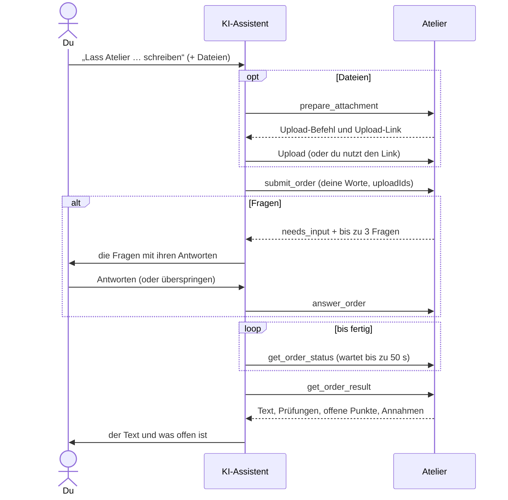

# Leitfaden: Atelier aus einem KI-Assistenten nutzen

***Deutsch** · [English](13-ai-assistant-guide.md)*

*Letzte Aktualisierung: 2026-11-27 (`extraCareful` entfernt, zweiter Zusatz zu D-087; D-091: Stufe 8d, ältere Werkzeuge entfernt, fünf Stummel für eine Version; davor Websuche für alle eingeschaltet, Zusatz zu D-074; `profile` speichert vier About-me-Angaben, D-083)*

Dieser Leitfaden ist für alle, die Atelier aus einem KI-Assistenten wie Claude Code nutzen wollen. Assistenten verbinden sich über **MCP** (Model Context Protocol), einen verbreiteten Weg, auf dem Assistenten
fremde Werkzeuge benutzen. Den technischen Vertrag jedes Werkzeugs beschreiben [04-mcp-integration_de.md](04-mcp-integration_de.md)
und [09-endpoint-reference_de.md](09-endpoint-reference_de.md).

## Was du bekommst

Du bittest deinen Assistenten in normalen Worten, zum Beispiel: „Lass Atelier eine kurze Notiz für das schwarze Brett schreiben.“
Der Assistent

1. gibt deinen Auftrag **wörtlich** weiter (die Serveranweisungen sagen ihm, ihn nicht umzuschreiben, zusammenzufassen oder zu
   übersetzen),
2. lädt deine Dateien hoch, wenn du ihm welche gibst,
3. stellt dir die Fragen von Atelier (höchstens drei, mit Antwortmöglichkeiten; Überspringen ist in Ordnung),
4. wartet auf den Text,
5. zeigt dir den Text **zusammen mit** dem, was geprüft wurde, den offenen Punkten und den Annahmen.

Der Unterschied dazu, den Assistenten selbst schreiben zu lassen: Atelier liest deine Dateien vollständig, lässt Lücken sichtbar,
statt sie zu füllen, und liefert einen festen Bericht, was geprüft wurde und was nicht. Die Serveranweisungen sagen dem
Assistenten, nicht mehr als geprüft zu melden, als Atelier sagt, und Lücken nicht selbst zu füllen. Ob ein Assistent diese
Anweisungen befolgt, hängt vom Assistenten ab; das vollständige Ergebnis steht immer auf der Auftragsseite unter **My work** in der
Web-App.

## Verbinden

Die Adresse ist die Atelier-Adresse mit `/mcp` dahinter, zum Beispiel `https://atelier.example/mcp`. Die Seite How it works in der
App zeigt die genaue Adresse deines Ateliers.

**Was geprüft ist:** Claude Code, auch über eine in claude.ai eingerichtete Verbindung, mit einem kompletten Auftrag samt Datei
und Rückfrage. Die Nutzung aus dem Chatfenster von claude.ai selbst und aus Claude Desktop ist nicht geprüft.

- **Claude Code:** `claude mcp add --transport http atelier https://atelier.example/mcp` und bei Nachfrage anmelden. Die
  Administration kann auch einen festen Schlüssel (Bearer-Token) nutzen; Aufträge damit gehören dem für diesen Schlüssel
  eingestellten Konto.
- **Connector in claude.ai hinzufügen:** einen eigenen Connector mit dieser Adresse anlegen. Der Assistent öffnet die
  Anmeldeseite von Atelier; anmelden und Zugriff erlauben (OAuth). Ab dann handelt er als du. Öffnet sich die Anmeldeseite nicht,
  frag die Administration.
- **OAuth-Clients:** Jede angemeldete Person kann unter **OAuth clients** im Menü einen Assistenten eintragen; löschen kann ihn nur
  die Administration.
- **Ansehen und entfernen** kannst du deine verbundenen Assistenten unter **Connected clients** in deinem Menü.

## Die Werkzeuge

Die Liste zeigt, was der Server anbietet, solange das Upload-Ticket eingeschaltet ist (`Uploads:Tickets = On`). Ein Test
vergleicht diese Tabelle mit dem Werkzeugkatalog des Servers, sie kann also nicht unbemerkt veralten.

<!-- tools:start -->
| Werkzeug | Wofür |
|---|---|
| `prepare_attachment` | Bereitet das Hochladen einer Datei vor: ein einmaliger Upload-Befehl (15 Minuten gültig) und eine Upload-Seite (24 Stunden, nach Anmeldung). Nur solange `Uploads:Tickets` `On` ist. |
| `submit_order` | Gibt einen Auftrag mit dem Wortlaut der Person auf, optional mit `uploadIds`. |
| `answer_order` | Schickt die Antworten auf die Fragen (oder `skip=true`). |
| `get_order_status` | Wartet bis zu 50 Sekunden auf eine Änderung; `done` sagt, wann das Ergebnis bereit ist. |
| `get_order_result` | Der Text mit `checks`, offenen Punkten, Annahmen und, falls recherchiert wurde, `lookedUp`. |
| `revise_order` | Bittet mit den Worten der Person um eine Änderung und schreibt eine neue Version. Antwortet „Changing a text is not available yet.“, solange Ändern für die Person aus ist. |
| `export_order` | Der Text als Markdown-, Word- oder PDF-Datei (dieselbe Datei wie der Download im Web). |
| `cancel_order` | Hält einen Auftrag an. |
| `list_orders` | Die letzten Aufträge der Person. |
| `profile` | Zeigt die About-me-Angaben. Speichert Namen, Gruß, Anrede und Sprache, wenn die Person es will, nur in leere Felder (nur lesend, solange `Orders:TellOnce` `Off` ist). |
<!-- tools:end -->

Ohne Upload-Ticket gehen Dateien als Base64 in `attachments`, was nur für kleine Dateien funktioniert.

**Ältere Werkzeuge.** Die Werkzeuge der älteren Arbeitsweise wurden in Stufe 8d entfernt (D-091). Für eine Version bleiben fünf
Namen als Stummel gelistet, weil Clients Werkzeuglisten zwischenspeichern: `submit_request`, `submit_auto_crew_request`,
`get_run_status`, `get_run_result` und `get_run_details`. Alle ihre Parameter sind optional, ihre Beschreibung beginnt mit
„Removed: use … instead.“, und jeder Aufruf scheitert mit einer Fehlermeldung, die den Nachfolger nennt (`submit_order`,
`get_order_status`, `get_order_result`). Alle anderen alten Werkzeugnamen gibt es nicht mehr. Aufträge aus früheren Versionen
bleiben über `list_orders` und `get_order_result` erreichbar. Den Parameter `extraCareful` hat `submit_order` nicht mehr (zweiter
Zusatz zu D-087); ein Aufruf mit `extraCareful=true` aus einer gespeicherten
alten Werkzeugliste wird mit einem klaren Satz abgelehnt, und es entsteht kein Auftrag.

## Dateien

- Mit eingeschaltetem Upload-Ticket ruft der Assistent für jede Datei `prepare_attachment` auf. Kann er Shell-Befehle ausführen,
  lädt er die Datei mit dem gelieferten `curl`-Befehl hoch; sonst gibt er dir den Upload-Link und wartet, bis du Bescheid sagst.
  Die Datei kommt Byte für Byte an.
- Wird eine Datei abgelehnt, soll der Assistent dir den Grund wörtlich nennen und dieselbe Datei nicht noch einmal versuchen.
- PDF, Word, Markdown und Text, bis 25 MB. Eine Datei, die zu lang ist, um vollständig genutzt zu werden, wird auf diesem Weg
  abgelehnt; dann den Auftrag in der Web-App beginnen und dort Seiten wählen.
- Dateien lassen sich später nicht nachreichen.
- Atelier schickt deine Dateien nie an eine Websuche.

## About me

- `get_order_result` nennt in `aboutMeMissing`, was Atelier annehmen oder offen lassen musste (`sender`, `signature`, `formality`,
  `language`), weil die Person dazu unter About me nichts hat. Der Assistent soll die Person fragen, ob sie es einmal speichern
  will, und dann `profile` mit ihren eigenen Worten aufrufen (`name`, `signature`, `formality` `formal|informal`, `language` als
  Zwei-Buchstaben-Code). Er soll nie einen Wert aus dem Text, einer Datei oder einem Ergebnis übernehmen und nie einen raten. Gefüllt
  werden nur leere Felder; ein schon belegtes bleibt, und die Antwort sagt „Already set, so not changed: …“. Ein Name muss eine Zeile
  sein; eine Unterschrift darf Zeilenumbrüche haben, aber keine anderen Steuerzeichen und keine Zeile, die mit einem Feldnamen von About
  me wie „Never do this:“ beginnt.
- `fromAboutMe` nennt, was der Schreiber mit dieser Fassung aus About me bekam (gesendet, nicht unbedingt verwendet); ändern oder löschen kann die Person es unter About me in der Web-App, das gilt für die nächsten Aufträge – eine Änderung eines vorhandenen Textes behält, womit er entstand.
- Beides steht nur in der Antwort für die Person, die den Text bestellt hat. `profile` speichert nur in die eigenen
  About-me-Angaben, auch bei Administratoren. Mit `Orders:TellOnce = Off` fehlen beide Felder, und `profile` wird nur lesend angeboten.

## Websuche

- `submit_order` kann im Web nachschlagen (seit dem Zusatz zu D-074 für alle eingeschaltet; die Administration kann es abschalten,
  auch je Person), nur für die erste Version, nur wenn die Rückfragen-Stufe lief und nur, wenn der Auftrag keine Dateien hat. Der
  Suchdienst bekommt kurze Suchwörter aus dem Auftrag. Atelier versucht, Mailadressen, Telefonnummern, Kontonummern und Straßenanschriften wegzulassen, die es erkennt. Es erkennt
  nicht jede Schreibweise, und Namen oder andere persönliche Angaben aus dem Auftrag können in den Suchwörtern landen. Antworten
  und Dateien werden nie gesendet. Wörter aus den About-me-Angaben werden zurückgehalten, außer sie stehen auch im Auftrag; eine
  übersetzte oder umformulierte Angabe kann aber durchrutschen. `lookedUp.searchWords` nennt die gesendeten Wörter (nur beim
  eigenen Auftrag, auch ohne Text).
  `revise_order` sucht nicht neu. Ist die Tagesgrenze erreicht, wird der Text ohne Nachschlagen geschrieben, und `lookedUp` sagt
  es; der Auftrag scheitert nicht.

## Grenzen

- Atelier ist kein Chat: Nach den Fragen arbeitet es im Hintergrund. Ein Auftrag kann zwischen weniger als einer Minute und einigen
  Minuten dauern.
- Der Assistent kann verkürzen, was er dir zeigt. Die Auftragsseite in der Web-App zeigt alles.
- Ändern hängt an einem Schalter (siehe How it works). Atelier bittet den Schreiber, nur die gewünschte Änderung zu machen, prüft
  aber nicht, dass sonst nichts geändert wurde.
- Der Faktenprüfer meldet Stellen, die vielleicht nicht gestützt sind; in der Standardeinstellung ändert er den Text nicht, und er
  kann etwas übersehen.
