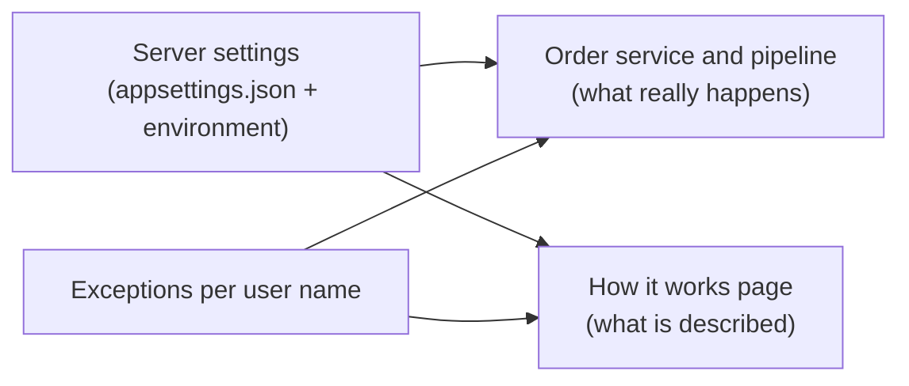

# Guide: running Atelier for others

*[Deutsch](14-admin-guide_de.md) · **English***

*Last updated: 2026-11-27 ("Extra careful" removed with its switch, second addendum to D-087; D-091: stage 8d, workshop editors, older review loop and older MCP tools removed with their switches; before that `Orders:TellOnce = On`, addendum to D-083; `Research:Mode = On`, addendum to D-074)*

This guide is for administrators: people who add accounts, decide which features are on and look after the providers. How
to install and host Atelier is in the [developer and host guide](15-developer-guide.md) and the [README](../README.md).

## What administrators can do

| Task | Where |
|---|---|
| Add, change, deactivate or delete accounts | Menu → **User management** (`/admin/users`) |
| Delete registered AI assistants (OAuth clients); registering one is open to every signed-in person | Menu → **OAuth clients** (`/admin/oauth-clients`) |
| Operator details for imprint and privacy pages | Menu → **Site settings** (`/admin/site-settings`) |
| See and stop every request | **My work** with "Show all users"; an order page of another account opens for administrators |
| Runs, the technical records behind the orders | Menu → **Workshop** → **Runs** (`/runs`, menu by default only for administrators) |
| Providers of AI models | Menu → **Workshop** → **Providers** (`/crew/providers`, administrators only) |
| Switch features on or off | Server settings (below) |

Administrators cannot change another person's text ("Change something" and `revise_order` are for the owner only, D-075). They
can export and stop it.

## Switching features

Features that are not meant for everyone have a switch. A switch can be set for everyone and, for four of them, first for single
people (an exception per user name). For questions, changing a text, looking things up, the fact check, files from an assistant and
"Tell Atelier once", the page **How it works** (`/how-it-works`) reads the same settings and the same exceptions, so it does not
show one of these as available that the viewer does not get, and it needs no change when you switch one on.

| Feature | Setting | Code default | Shipped in `appsettings.json` | Exception per person |
|---|---|---|---|---|
| Questions before the start | `Orders:IntakeMode` (`Off`, `Shadow`, `On`) | `Shadow` | `On` (D-072) | – |
| Changing a finished text | `Orders:Revise` (`Off`, `On`) | `Off` | `On` (D-078) | `Orders:ReviseOverrides:<user>` |
| Looking things up on the web (standard way) | `Research:Mode` (`Off`, `On`) | `Off` | `On` (addendum to D-074) | `Research:ModeOverrides:<user>` |
| Fact check | `Direct:FactCheckMode` (`Off`, `Shadow`, `Report`, `On`) | `Report` | `Report` (D-073) | `Direct:FactCheckModeOverrides:<user>` |
| Files from an AI assistant (upload ticket) | `Uploads:Tickets` (`Off`, `On`) | `Off` | `On` (D-076) | – |
| Workshop menu only for administrators | `Ui:WorkshopForAdminsOnly` | `true` | `true` (D-077) | – |
| Skill "how to use Atelier" for AI assistants | `Mcp:Skills` (`Off`, `On`) | `Off` | `On` (D-088, checked on the real client with Claude Code) | – |
| Questions as a form in the AI assistant | `Mcp:Elicitation` (`Off`, `On`) | `Off` | `On` (D-088, checked on the real client with Claude Code) | – |
| Offer to save missing details under About me (“Tell Atelier once”) | `Orders:TellOnce` (`Off`, `On`, `WithoutPromise`) | `WithoutPromise` | `On` (addendum to D-083, acceptance passed) | – |

What the values mean:

- **Fact check:** `Off` makes no call; `Shadow` checks and stores, shows nothing; `Report` checks and shows, never changes the
  text; `On` may also correct once (D-073). The page How it works describes any mode it does not know as "points things out".
- **Research** needs questions (`Orders:IntakeMode = On`), because its search topics come from reading the request. It never runs
  when the order has files, and only for the first version (D-074). Daily limits: `Research:DailyOrderCap`,
  `Research:DailyOrderCapPerUser`; when one is reached, the text is written without looking things up and the result says so. It
  needs a search key (`TAVILY_API_KEY`); without one nothing goes to a search service, but every result with research topics says
  that looking things up did not work, so switch it off (`Research__Mode=Off`, see “How to set a switch” below) if you set no key. The way back for everyone is
  `Research__Mode=Off`, for one person `Research__ModeOverrides__<user>=Off`. The switch counts twice: only a request that was read
  while research was on for the person can search, and only while it is still on; requests read before the switch was turned on
  never search. Atelier tries to hold back search words with an email address, a phone or account number, a date of birth or a
  street address that it recognizes; it does not recognize every form, names and other details in plain words not at all, and the
  person sees the words that went out on the result.
  The search service is set with `Tavily:Endpoint` and `Tavily:ApiKey` (`docker-compose.yml`
  fills the key from `TAVILY_API_KEY`).
- **Workshop menu:** with `true`, only administrators see the menu "Workshop" ("Runs", and "Providers" for administrators) and
  "Technical details" on the order page. The run pages still open for anyone signed in who types their address and show only their
  own runs (D-077); the provider pages are for administrators only, whatever the switch says.
- **Tell Atelier once:** shows the owner of a result one field per topic (sender, signature, form of address, language) that the
  reading of the request had to assume or leave open while About me has nothing on it, and the line “With this request the writer got
  from About me: …”; AI assistants get the same as `aboutMeMissing`/`fromAboutMe` and can save these four fields with `profile`. Saving
  fills only fields that are still empty, in one locked step, and never overwrites. `On` (shipped since the acceptance passed) uses
  the heading “Tell Atelier once – your next requests get it from About me”: every new request gets the detail, and a request that is read first no longer assumes it or asks for it; a change of an existing text keeps the details it was written with. `WithoutPromise` (the code default) uses “Save it
  under About me for your next texts”. `Off` shows none of it, and `profile` is offered read
  only with its earlier description. Administrators never see it on someone else's order, and saving goes only into the own About me
  (D-083). Way back: `Orders__TellOnce=WithoutPromise` (offer without the promise) or `Orders__TellOnce=Off`.

**How to set a switch.** The settings are read at start. Set them as environment variables of the web service, with `__` in place
of `:` (for example `Orders__Revise=On`, `Orders__ReviseOverrides__alice=On`). `docker-compose.yml` passes variables one by one,
so put them under `environment` of the web service in a `docker-compose.override.yml`; an `.env` file alone is not enough. Then
recreate the container. Every switch can be set back the same way.

**Settings that no longer exist** (removed in stage 8d, D-091): `Mcp:LegacyTools`, `Orders:LegacySubmitDefaultMode`,
`Convergence:BestDraft`, `Convergence:WriterBlockingOnly`, `Convergence:StopWithoutProgress` and their `…Overrides`,
`Orders:CarefulOutline` with `Orders:CarefulOutlineOverrides` (second addendum to D-087), and everything under `Learning:`, `Knowledge:`, `Embeddings:` and `Finalizer:`. They do nothing; you can delete them from your environment.

## Accounts and AI assistants

- The first administrator comes from `ATELIER_USER` and `ATELIER_PASSWORD_HASH` and is created or synchronised at start.
- Every account sees only its own orders; administrators see all.
- An AI assistant connected with OAuth acts as the person who allowed it. Orders placed with the fixed key (bearer token) belong to
  `AtelierMcp:StaticTokenUser`, otherwise to the first administrator; without either, `submit_order` refuses (D-070).
- Deactivating or deleting an account revokes its tokens. Deleting an account deletes its About me details (D-071).

## Providers and models

Atelier writes with one setup that exists only in code: the standard way. You do not build teams or edit role
descriptions; those editors were removed in stage 8d (D-091).

- **Models** are chosen by role from the model matrix and the live model catalog at the start of each run, not picked by hand
  (D-066). Claude runs through the CLI gateway as `claude-cli`, OpenAI as `codex-cli`.
- **Providers** (`/crew/providers`, administrators only): the HTTP providers come with the system and are read-only; you can add a
  CLI provider.
- **Runs** (`/runs`): every version of an order is one run. The run page shows the setup, the rounds, findings, tokens and cost. A
  failed or stopped run of the standard way can be resumed there.

## Database

One baseline migration builds the schema (D-092). The application does not start on a database that does not start from it and
changes nothing there; the log says why. There is no automatic upgrade for an installation from before D-092: take a backup and set it up again with an empty
database (accounts, providers and settings have to be entered again), or convert its schema by hand to match the baseline.
To go back to an image from before D-092, restore that backup.

## Things to watch

- The fact check also points at harmless sentences (closings, signatures) and can miss things (D-075). Tell people to read the open
  points, not to trust a short list.
- A change of the clarifier or fact-check prompt makes the stored measurements invalid (D-072, D-073); such changes need a new
  measurement before they ship.
