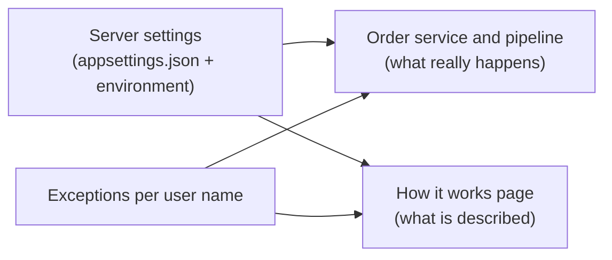

# Guide: running Atelier for others

*[Deutsch](14-admin-guide_de.md) · **English***

*Last updated: 2026-11-27 (`Orders:TellOnce = On`, addendum to D-083; `Research:Mode = On`, addendum to D-074; switches of the older review loop, D-085; before that 2026-11-26 `Orders:TellOnce`, D-083; before that after review: web search outside the standard way, OAuth clients)*

This guide is for administrators: people who add accounts, decide which features are on and look after the older workshop. How
to install and host Atelier is in the [developer and host guide](15-developer-guide.md) and the [README](../README.md).

## What administrators can do

| Task | Where |
|---|---|
| Add, change, deactivate or delete accounts | Menu → **User management** (`/admin/users`) |
| Delete registered AI assistants (OAuth clients); registering one is open to every signed-in person | Menu → **OAuth clients** (`/admin/oauth-clients`) |
| Operator details for imprint and privacy pages | Menu → **Site settings** (`/admin/site-settings`) |
| See and stop every request | **My work** with "Show all users"; an order page of another account opens for administrators |
| The older workshop: teams, profiles, providers, models | Menu → **Workshop** (by default only for administrators) |
| Switch features on or off | Server settings (below) |

Administrators cannot change another person's text ("Change something" and `revise_order` are for the owner only, D-075). They
can export and stop it.

## Switching features

Every feature that is not yet meant for everyone has a switch. A switch can be set for everyone and, for three of them, first for
single people (an exception per user name). The page **How it works** (`/how-it-works`) reads the same settings and the same
exceptions, so it never shows a feature as available that the viewer does not get, and it needs no change when you switch a
feature on.

| Feature | Setting | Code default | Shipped in `appsettings.json` | Exception per person |
|---|---|---|---|---|
| Questions before the start | `Orders:IntakeMode` (`Off`, `Shadow`, `On`) | `Shadow` | `On` (D-072) | – |
| Changing a finished text | `Orders:Revise` (`Off`, `On`) | `Off` | `On` (D-078) | `Orders:ReviseOverrides:<user>` |
| Looking things up on the web (standard way) | `Research:Mode` (`Off`, `On`) | `Off` | `On` (addendum to D-074) | `Research:ModeOverrides:<user>` |
| Fact check | `Direct:FactCheckMode` (`Off`, `Shadow`, `Report`, `On`) | `Report` | `Report` (D-073) | `Direct:FactCheckModeOverrides:<user>` |
| Files from an AI assistant (upload ticket) | `Uploads:Tickets` (`Off`, `On`) | `Off` | `On` (D-076) | – |
| Workshop menu only for administrators | `Ui:WorkshopForAdminsOnly` | `true` | `true` (D-077) | – |
| Older tools for AI assistants | `Mcp:LegacyTools` | `true` | `true` (D-075) | – |
| Skill "how to use Atelier" for AI assistants | `Mcp:Skills` (`Off`, `On`) | `Off` | `On` (D-088, checked on the real client with Claude Code) | – |
| Questions as a form in the AI assistant | `Mcp:Elicitation` (`Off`, `On`) | `Off` | `On` (D-088, checked on the real client with Claude Code) | – |
| Learning loop of the older way | `Learning:Enabled` | `false` | `false` (D-067) | – |
| Offer to save missing details under About me (“Tell Atelier once”) | `Orders:TellOnce` (`Off`, `On`, `WithoutPromise`) | `WithoutPromise` | `On` (addendum to D-083, acceptance passed) | – |
| Older review loop: best instead of most recent version | `Convergence:BestDraft` (`Off`, `On`) | `Off` | `Off` (D-085) | – |
| Older review loop: writer gets only blocking findings | `Convergence:WriterBlockingOnly` (`Off`, `On`) | `Off` | `Off` (D-085) | – |
| Older review loop: stop after two rounds without progress | `Convergence:StopWithoutProgress` (`Off`, `On`) | `Off` | `Off` (D-085) | – |

What the values mean:

- **Fact check:** `Off` makes no call; `Shadow` checks and stores, shows nothing; `Report` checks and shows, never changes the
  text; `On` may also correct once (D-073). The page How it works describes any mode it does not know as "points things out".
- **Research** needs questions (`Orders:IntakeMode = On`), because its search topics come from reading the request. It never runs
  when the order has files, and only for the first version (D-074). Daily limits: `Research:DailyOrderCap`,
  `Research:DailyOrderCapPerUser`; when one is reached, the text is written without looking things up and the result says so. It
  needs a search key (`TAVILY_API_KEY`); without one nothing goes to a search service, but every result with research topics says
  that looking things up did not work, so switch it off (`Research__Mode=Off`, see “How to set a switch” below) if you set no key. The way back for everyone is
  `Research__Mode=Off`, for one person `Research__ModeOverrides__<user>=Off`. The switch counts twice: only a request that was read
  while research was on for the person can search, and only while it is still on; requests read before the switch was turned on
  never search. Atelier tries to hold back search words with an email address, a phone or account number, a date of birth or a
  street address that it recognizes; it does not recognize every form, names and other details in plain words not at all, and the
  person sees the words that went out on the result. This switch
  covers the standard way only. "Extra careful" never searches the web. A workshop
  template or an own team that someone chooses explicitly – on the older form `/new` or through the older tools (`submit_request`
  with `crewTemplate` or `customCrew`, `submit_auto_crew_request`) – uses the sources of that team, and these can include a web
  search whenever a search key is set, whatever `Research:Mode` says.
- **Workshop:** with `true`, only administrators see the menu "Workshop", the link to the older form on the start page and
  "Technical details" on the order page. The pages themselves still open for anyone signed in who types their address (D-077).
- **Tell Atelier once:** shows the owner of a result one field per topic (sender, signature, form of address, language) that the
  reading of the request had to assume or leave open while About me has nothing on it, and the line “With this request the writer got
  from About me: …”; AI assistants get the same as `aboutMeMissing`/`fromAboutMe` and can save these four fields with `profile`. Saving
  fills only fields that are still empty, in one locked step, and never overwrites. `On` (shipped since the acceptance passed) uses
  the heading “Tell Atelier once – your next requests get it from About me”: every new request gets the detail, and a request that is read first no longer assumes it or asks for it; a change of an existing text keeps the details it was written with. `WithoutPromise` (the code default) uses “Save it
  under About me for your next texts”. `Off` shows none of it, and `profile` is offered read
  only with its earlier description. Administrators never see it on someone else's order, and saving goes only into the own About me
  (D-083). Way back: `Orders__TellOnce=WithoutPromise` (offer without the promise) or `Orders__TellOnce=Off`.
- **Older review loop** (“Extra careful”, workshop templates and resumed runs; never the standard way or the team draft): rounds are
  compared only over the reviewers that failed for technical reasons in none of the rounds compared. A round is better when it has
  fewer “critical” findings and, with as many, fewer blocking ones (“major” or “critical”). `BestDraft` delivers the best round after
  a loop without approval (on a tie the one with fewer outages, then the most recent) and stores it as the delivered round; only a
  text that is not blank and has at least 70 % of the length of the longest round text is chosen, otherwise the earlier choice
  stays. An approved loop delivers its last round as before.
  `WriterBlockingOnly` hands the writer only the blocking findings of the last round, no outage notes. `StopWithoutProgress` ends
  the loop when two rounds in a row brought no round better than all before (same comparison; no stop without a reviewer that
  answered in every round); the run then gives the reason “Two more rounds did not reduce the open points, so the work was
  stopped.” Approval, the round limit and the time limit come first. All three stay
  off until the measurement of the new “Extra careful” has decided on them (D-085).
  Measuring accounts can get each switch per user name (`Convergence__BestDraftOverrides__<name>=On`,
  `…WriterBlockingOnlyOverrides…`, `…StopWithoutProgressOverrides…`; shipped empty, D-087).
- **“Extra careful” with an outline** (`Orders:CarefulOutline`, `Off`/`On`, shipped `Off`; exceptions per user name
  `Orders__CarefulOutlineOverrides__<name>=On`): with `On`, an “Extra careful” order without a chosen team runs on the standard way with
  one call first that splits the text into sections with word budgets (taken from the requested length when it can be read without a
  model); the writer then writes along it, with the same automatic checks, the same fact check and the same “What was checked” as the
  standard way, plus a check after the first version whether every explicit requirement of the request is met (otherwise one
  correction). If no usable outline comes back, the text is written in one go and the order says so. A chosen team, changes and resumed
  runs never plan. Stays off until the measurement of package 7 has decided (D-087).

**How to set a switch.** The settings are read at start. Set them as environment variables of the web service, with `__` in place
of `:` (for example `Orders__Revise=On`, `Orders__ReviseOverrides__alice=On`). `docker-compose.yml` passes variables one by one,
so put them under `environment` of the web service in a `docker-compose.override.yml`; an `.env` file alone is not enough. Then
recreate the container. Every switch can be set back the same way.

## Accounts and AI assistants

- The first administrator comes from `ATELIER_USER` and `ATELIER_PASSWORD_HASH` and is created or synchronised at start.
- Every account sees only its own orders; administrators see all.
- An AI assistant connected with OAuth acts as the person who allowed it. Orders placed with the fixed key (bearer token) belong to
  `AtelierMcp:StaticTokenUser`, otherwise to the first administrator; without either, `submit_order` refuses (D-070).
- Deactivating or deleting an account revokes its tokens. Deleting an account deletes its About me details (D-071).

## The older workshop

The workshop is the way of working that existed before the rebuild of November 2026: teams ("crews") of AI roles that you set up
yourself, with executors, reviewers, advisors, sources ("grounding"), finishing steps and specialisation packs. "Extra careful"
on the start page and the older tools for AI assistants still use it. Its parts are described in
[08-crew-system.md](08-crew-system.md), [10-tool-system.md](10-tool-system.md) and [11-specialization-packs.md](11-specialization-packs.md).

What to know:

- **Models** are chosen by role from the model matrix, not freely (D-066). Claude runs through the CLI gateway as
  `claude-cli`, OpenAI as `codex-cli`. Profiles set to "Manual" keep their model.
- The agentic tool path was never wired into the pipeline and is frozen; the learning loop is paused (D-067).
- Removing the older way waits for the trigger in D-077; nothing of it is deleted before.

## Things to watch

- Results of "Extra careful" have no "What was checked".
- The fact check also points at harmless sentences (closings, signatures) and can miss things (D-075). Tell people to read the open
  points, not to trust a short list.
- A change of the clarifier or fact-check prompt makes the stored measurements invalid (D-072, D-073); such changes need a new
  measurement before they ship.
