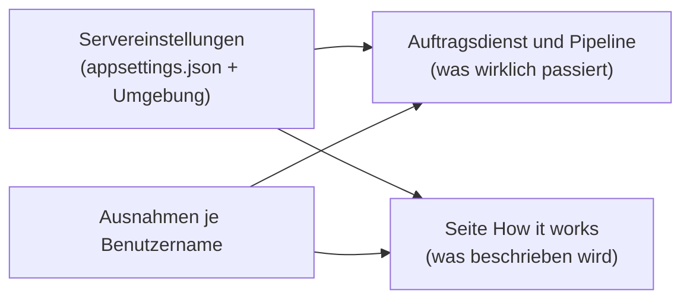

# Leitfaden: Atelier für andere betreiben

***Deutsch** · [English](14-admin-guide.md)*

*Letzte Aktualisierung: 2026-11-26 (nach Prüfung: Websuche außerhalb des Standardwegs, OAuth-Clients)*

Dieser Leitfaden ist für die Administration: Menschen, die Konten anlegen, entscheiden, welche Funktionen an sind, und sich um die
ältere Werkstatt kümmern. Installation und Betrieb beschreiben der [Leitfaden für Entwicklung und Betrieb](15-developer-guide_de.md)
und das [README](../README_de.md).

## Was die Administration tun kann

| Aufgabe | Wo |
|---|---|
| Konten anlegen, ändern, deaktivieren oder löschen | Menü → **User management** (`/admin/users`) |
| Eingetragene KI-Assistenten löschen (OAuth-Clients); eintragen kann jede angemeldete Person | Menü → **OAuth clients** (`/admin/oauth-clients`) |
| Betreiberangaben für Impressum und Datenschutz | Menü → **Site settings** (`/admin/site-settings`) |
| Alle Aufträge sehen und anhalten | **My work** mit „Show all users“; die Auftragsseite eines anderen Kontos öffnet sich für die Administration |
| Die ältere Werkstatt: Teams, Profile, Anbieter, Modelle | Menü → **Workshop** (standardmäßig nur für die Administration) |
| Funktionen ein- oder ausschalten | Servereinstellungen (unten) |

Den Text einer anderen Person kann die Administration nicht ändern („Change something“ und `revise_order` gelten nur für die
Person, der der Auftrag gehört, D-075). Exportieren und anhalten kann sie ihn.

## Funktionen schalten

Jede Funktion, die noch nicht für alle gedacht ist, hat einen Schalter. Ein Schalter gilt für alle und kann bei dreien zuerst für
einzelne Personen gesetzt werden (Ausnahme je Benutzername). Die Seite **How it works** (`/how-it-works`) liest dieselben
Einstellungen und dieselben Ausnahmen; sie zeigt also nie etwas als verfügbar, was die betrachtende Person nicht bekommt, und
muss beim Einschalten nicht geändert werden.

| Funktion | Einstellung | Standard im Code | Ausgeliefert in `appsettings.json` | Ausnahme je Person |
|---|---|---|---|---|
| Fragen vor dem Start | `Orders:IntakeMode` (`Off`, `Shadow`, `On`) | `Shadow` | `On` (D-072) | – |
| Fertigen Text ändern | `Orders:Revise` (`Off`, `On`) | `Off` | `On` (D-078) | `Orders:ReviseOverrides:<user>` |
| Im Web nachschlagen (Standardweg) | `Research:Mode` (`Off`, `On`) | `Off` | `Off` (D-074) | `Research:ModeOverrides:<user>` |
| Faktenprüfung | `Direct:FactCheckMode` (`Off`, `Shadow`, `Report`, `On`) | `Report` | `Report` (D-073) | `Direct:FactCheckModeOverrides:<user>` |
| Dateien aus einem KI-Assistenten (Upload-Ticket) | `Uploads:Tickets` (`Off`, `On`) | `Off` | `On` (D-076) | – |
| Werkstatt-Menü nur für die Administration | `Ui:WorkshopForAdminsOnly` | `true` | `true` (D-077) | – |
| Ältere Werkzeuge für KI-Assistenten | `Mcp:LegacyTools` | `true` | `true` (D-075) | – |
| Lernschleife des älteren Wegs | `Learning:Enabled` | `false` | `false` (D-067) | – |

Was die Werte bedeuten:

- **Faktenprüfung:** `Off` ruft nichts auf; `Shadow` prüft und speichert, zeigt nichts; `Report` prüft und zeigt, ändert den Text
  nie; `On` darf zusätzlich einmal korrigieren (D-073). Einen Modus, den sie nicht kennt, beschreibt die Seite How it works als
  „meldet“ („points things out“).
- **Recherche** braucht die Fragen (`Orders:IntakeMode = On`), weil ihre Suchthemen aus dem Lesen des Auftrags stammen. Sie läuft
  nie, wenn der Auftrag Dateien hat, und nur für die erste Version (D-074). Tagesgrenzen: `Research:DailyOrderCap`,
  `Research:DailyOrderCapPerUser`. Dieser Schalter gilt nur für den Standardweg. „Extra careful“ sucht nie im Web. Eine
  Werkstatt-Vorlage oder ein eigenes Team, das jemand ausdrücklich wählt – im älteren Formular `/new` oder über die älteren
  Werkzeuge (`submit_request` mit `crewTemplate` oder `customCrew`, `submit_auto_crew_request`) –, nutzt die Quellen dieses Teams,
  und dazu kann eine Websuche gehören, sobald ein Suchschlüssel gesetzt ist, unabhängig von `Research:Mode`.
- **Werkstatt:** Mit `true` sehen nur Administratoren das Menü „Workshop“, den Link zum älteren Formular auf der Startseite und
  „Technical details“ auf der Auftragsseite. Die Seiten selbst öffnen sich weiter für alle Angemeldeten, die ihre Adresse eingeben
  (D-077).

**Einen Schalter setzen.** Die Einstellungen werden beim Start gelesen. Setz sie als Umgebungsvariablen des Webdienstes, mit `__`
statt `:` (zum Beispiel `Orders__Revise=On`, `Orders__ReviseOverrides__alice=On`). `docker-compose.yml` reicht Variablen einzeln
durch; trag sie deshalb unter `environment` des Webdienstes in einer `docker-compose.override.yml` ein – eine `.env`-Datei allein
genügt nicht. Danach den Container neu erstellen. Jeder Schalter lässt sich auf demselben Weg zurücksetzen.

## Konten und KI-Assistenten

- Der erste Administrator kommt aus `ATELIER_USER` und `ATELIER_PASSWORD_HASH` und wird beim Start angelegt oder abgeglichen.
- Jedes Konto sieht nur seine eigenen Aufträge; die Administration sieht alle.
- Ein per OAuth verbundener KI-Assistent handelt als die Person, die ihn zugelassen hat. Aufträge mit dem festen Schlüssel
  (Bearer-Token) gehören `AtelierMcp:StaticTokenUser`, sonst dem ersten Administrator; ohne beides lehnt `submit_order` ab (D-070).
- Deaktivieren oder Löschen eines Kontos widerruft seine Tokens. Löschen eines Kontos löscht seine About-me-Angaben (D-071).

## Die ältere Werkstatt

Die Werkstatt ist die Arbeitsweise aus der Zeit vor dem Umbau im November 2026: Teams („Crews“) aus KI-Rollen, die man selbst
zusammenstellt, mit Schreibern, Prüfern, Beratern, Quellen („Grounding“), Abschlussschritten und Spezialisierungs-Packs. „Extra
careful“ auf der Startseite und die älteren Werkzeuge für KI-Assistenten nutzen sie noch. Ihre Teile beschreiben
[08-crew-system_de.md](08-crew-system_de.md), [10-tool-system_de.md](10-tool-system_de.md) und
[11-specialization-packs_de.md](11-specialization-packs_de.md).

Gut zu wissen:

- **Modelle** werden nach Rolle aus der Modellmatrix gewählt, nicht frei (D-066). Claude läuft über das CLI-Gateway als
  `claude-cli`, OpenAI als `codex-cli`. Profile auf „Manual“ behalten ihr Modell.
- Der agentische Werkzeugpfad wurde nie mit der Pipeline verdrahtet und ist eingefroren; die Lernschleife ist pausiert (D-067).
- Der Rückbau des älteren Wegs wartet auf den Auslöser in D-077; vorher wird davon nichts gelöscht.

## Worauf achten

- Ergebnisse von „Extra careful“ haben kein „What was checked“.
- Der Faktenprüfer meldet auch harmlose Sätze (Schlussformeln, Unterschriften) und kann etwas übersehen (D-075). Sag den Leuten,
  dass sie die offenen Punkte lesen sollen, statt einer kurzen Liste zu vertrauen.
- Eine Änderung am Prompt des Klärers oder des Faktenprüfers macht die gespeicherten Messungen ungültig (D-072, D-073); solche
  Änderungen brauchen vor der Auslieferung eine neue Messung.
