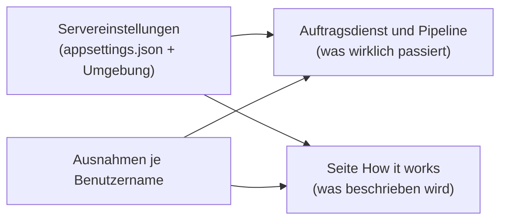

# Leitfaden: Atelier für andere betreiben

***Deutsch** · [English](14-admin-guide.md)*

*Letzte Aktualisierung: 2026-11-27 („Extra careful“ samt Schalter entfernt, zweiter Zusatz zu D-087; D-091: Stufe 8d, Werkstatt-Editoren, ältere Prüfschleife und ältere MCP-Werkzeuge samt Schaltern entfernt; davor `Orders:TellOnce = On`, Zusatz zu D-083; `Research:Mode = On`, Zusatz zu D-074)*

Dieser Leitfaden ist für die Administration: Menschen, die Konten anlegen, entscheiden, welche Funktionen an sind, und sich um die
Anbieter kümmern. Installation und Betrieb beschreiben der [Leitfaden für Entwicklung und Betrieb](15-developer-guide_de.md)
und das [README](../README_de.md).

## Was die Administration tun kann

| Aufgabe | Wo |
|---|---|
| Konten anlegen, ändern, deaktivieren oder löschen | Menü → **User management** (`/admin/users`) |
| Eingetragene KI-Assistenten löschen (OAuth-Clients); eintragen kann jede angemeldete Person | Menü → **OAuth clients** (`/admin/oauth-clients`) |
| Betreiberangaben für Impressum und Datenschutz | Menü → **Site settings** (`/admin/site-settings`) |
| Alle Aufträge sehen und anhalten | **My work** mit „Show all users“; die Auftragsseite eines anderen Kontos öffnet sich für die Administration |
| Läufe, die technischen Protokolle hinter den Aufträgen | Menü → **Workshop** → **Runs** (`/runs`, Menü standardmäßig nur für die Administration) |
| Anbieter von KI-Modellen | Menü → **Workshop** → **Providers** (`/crew/providers`, nur für die Administration) |
| Funktionen ein- oder ausschalten | Servereinstellungen (unten) |

Den Text einer anderen Person kann die Administration nicht ändern („Change something“ und `revise_order` gelten nur für die
Person, der der Auftrag gehört, D-075). Exportieren und anhalten kann sie ihn.

## Funktionen schalten

Funktionen, die nicht für alle gedacht sind, haben einen Schalter. Ein Schalter gilt für alle und kann bei vieren zuerst für
einzelne Personen gesetzt werden (Ausnahme je Benutzername). Für Fragen, Text ändern, Nachschlagen, Faktenprüfung, Dateien aus
einem Assistenten und „Tell Atelier once“ liest die Seite **How it works** (`/how-it-works`) dieselben Einstellungen und dieselben
Ausnahmen; sie zeigt davon also nichts als verfügbar, was die betrachtende Person nicht bekommt, und muss beim Einschalten nicht
geändert werden.

| Funktion | Einstellung | Standard im Code | Ausgeliefert in `appsettings.json` | Ausnahme je Person |
|---|---|---|---|---|
| Fragen vor dem Start | `Orders:IntakeMode` (`Off`, `Shadow`, `On`) | `Shadow` | `On` (D-072) | – |
| Fertigen Text ändern | `Orders:Revise` (`Off`, `On`) | `Off` | `On` (D-078) | `Orders:ReviseOverrides:<user>` |
| Im Web nachschlagen (Standardweg) | `Research:Mode` (`Off`, `On`) | `Off` | `On` (Zusatz zu D-074) | `Research:ModeOverrides:<user>` |
| Faktenprüfung | `Direct:FactCheckMode` (`Off`, `Shadow`, `Report`, `On`) | `Report` | `Report` (D-073) | `Direct:FactCheckModeOverrides:<user>` |
| Dateien aus einem KI-Assistenten (Upload-Ticket) | `Uploads:Tickets` (`Off`, `On`) | `Off` | `On` (D-076) | – |
| Werkstatt-Menü nur für die Administration | `Ui:WorkshopForAdminsOnly` | `true` | `true` (D-077) | – |
| Skill „wie man Atelier benutzt“ für KI-Assistenten | `Mcp:Skills` (`Off`, `On`) | `Off` | `On` (D-088, am echten Client mit Claude Code geprüft) | – |
| Rückfragen als Formular im KI-Assistenten | `Mcp:Elicitation` (`Off`, `On`) | `Off` | `On` (D-088, am echten Client mit Claude Code geprüft) | – |
| Angebot, fehlende Angaben unter About me zu speichern („Tell Atelier once“) | `Orders:TellOnce` (`Off`, `On`, `WithoutPromise`) | `WithoutPromise` | `On` (Zusatz zu D-083, Abnahme bestanden) | – |

Was die Werte bedeuten:

- **Faktenprüfung:** `Off` ruft nichts auf; `Shadow` prüft und speichert, zeigt nichts; `Report` prüft und zeigt, ändert den Text
  nie; `On` darf zusätzlich einmal korrigieren (D-073). Einen Modus, den sie nicht kennt, beschreibt die Seite How it works als
  „meldet“ („points things out“).
- **Recherche** braucht die Fragen (`Orders:IntakeMode = On`), weil ihre Suchthemen aus dem Lesen des Auftrags stammen. Sie läuft
  nie, wenn der Auftrag Dateien hat, und nur für die erste Version (D-074). Tagesgrenzen: `Research:DailyOrderCap`,
  `Research:DailyOrderCapPerUser`; ist eine erreicht, wird der Text ohne Nachschlagen geschrieben, und das Ergebnis sagt es. Sie
  braucht einen Suchschlüssel (`TAVILY_API_KEY`); ohne ihn geht nichts an einen Suchdienst, aber jedes Ergebnis mit Suchthemen
  meldet, dass das Nachschlagen nicht geklappt hat – ohne Schlüssel also ausschalten (`Research__Mode=Off`, siehe „Einen Schalter setzen“ unten). Rückweg für alle:
  `Research__Mode=Off`, für eine Person `Research__ModeOverrides__<user>=Off`. Der Schalter zählt doppelt: Suchen kann nur ein
  Auftrag, der gelesen wurde, während die Recherche für die Person an war, und nur, solange sie noch an ist; vor dem Einschalten
  gelesene Aufträge suchen nie. Atelier versucht, Suchwörter mit Mailadresse, Telefon- oder Kontonummer, Geburtsdatum oder
  Straßenanschrift zurückzuhalten, die es erkennt; es erkennt nicht jede Schreibweise, Namen und andere Angaben in Worten gar nicht,
  und die Person sieht am Ergebnis, welche Wörter hinausgingen.
  Den Suchdienst stellen `Tavily:Endpoint` und `Tavily:ApiKey` ein (`docker-compose.yml` füllt den
  Schlüssel aus `TAVILY_API_KEY`).
- **Menü Workshop:** Mit `true` sehen nur Administratoren das Menü „Workshop“ („Runs“ und für die Administration „Providers“) und
  „Technical details“ auf der Auftragsseite. Die Lauf-Seiten öffnen sich weiter für alle Angemeldeten, die ihre Adresse eingeben,
  und zeigen nur die eigenen Läufe (D-077); die Anbieter-Seiten sind unabhängig vom Schalter nur für die Administration.
- **Tell Atelier once:** zeigt der Person, der ein Ergebnis gehört, je Thema (Absender, Unterschrift, Anrede, Sprache), das beim
  Lesen des Auftrags angenommen oder offen gelassen werden musste und zu dem About me nichts hat, ein Feld, dazu die Zeile „With this
  request the writer got from About me: …“; KI-Assistenten bekommen dasselbe als `aboutMeMissing`/`fromAboutMe` und können diese vier
  Felder mit `profile` speichern. Gespeichert wird nur in Felder, die noch leer sind, in einem gesperrten Schritt, nie überschreibend.
  `On` (ausgeliefert, seit die Abnahme bestanden ist) nutzt die Überschrift „Tell Atelier once – your next requests get it from About me“: Jeder neue
  Auftrag bekommt die Angabe, und ein Auftrag, der zuerst gelesen wird, nimmt sie nicht mehr an und fragt nicht mehr danach; eine Änderung eines vorhandenen Textes behält die Angaben, mit
  denen er entstand. `WithoutPromise` (Code-Standard) nutzt „Save it under About me for your next texts“. `Off` zeigt nichts davon, und `profile` wird nur lesend mit seiner früheren Beschreibung angeboten. Die
  Administration sieht es nie an fremden Aufträgen, und gespeichert wird nur in die eigenen About-me-Angaben (D-083). Rückweg:
  `Orders__TellOnce=WithoutPromise` (Angebot ohne Zusage) oder `Orders__TellOnce=Off`.

**Einen Schalter setzen.** Die Einstellungen werden beim Start gelesen. Setz sie als Umgebungsvariablen des Webdienstes, mit `__`
statt `:` (zum Beispiel `Orders__Revise=On`, `Orders__ReviseOverrides__alice=On`). `docker-compose.yml` reicht Variablen einzeln
durch; trag sie deshalb unter `environment` des Webdienstes in einer `docker-compose.override.yml` ein – eine `.env`-Datei allein
genügt nicht. Danach den Container neu erstellen. Jeder Schalter lässt sich auf demselben Weg zurücksetzen.

**Einstellungen, die es nicht mehr gibt** (in Stufe 8d entfernt, D-091): `Mcp:LegacyTools`, `Orders:LegacySubmitDefaultMode`,
`Convergence:BestDraft`, `Convergence:WriterBlockingOnly`, `Convergence:StopWithoutProgress` samt ihren `…Overrides`,
`Orders:CarefulOutline` samt `Orders:CarefulOutlineOverrides` (zweiter Zusatz zu D-087) sowie alles unter `Learning:`, `Knowledge:`, `Embeddings:` und `Finalizer:`. Sie bewirken nichts; du kannst sie aus deiner Umgebung löschen.

## Konten und KI-Assistenten

- Der erste Administrator kommt aus `ATELIER_USER` und `ATELIER_PASSWORD_HASH` und wird beim Start angelegt oder abgeglichen.
- Jedes Konto sieht nur seine eigenen Aufträge; die Administration sieht alle.
- Ein per OAuth verbundener KI-Assistent handelt als die Person, die ihn zugelassen hat. Aufträge mit dem festen Schlüssel
  (Bearer-Token) gehören `AtelierMcp:StaticTokenUser`, sonst dem ersten Administrator; ohne beides lehnt `submit_order` ab (D-070).
- Deaktivieren oder Löschen eines Kontos widerruft seine Tokens. Löschen eines Kontos löscht seine About-me-Angaben (D-071).

## Anbieter und Modelle

Atelier schreibt mit einer Aufstellung, die nur im Code steht: dem Standardweg. Teams baust du nicht, und
Rollenbeschreibungen bearbeitest du nicht; diese Editoren wurden in Stufe 8d entfernt (D-091).

- **Modelle** werden beim Start jedes Laufs nach Rolle aus der Modellmatrix und dem Live-Modellkatalog gewählt, nicht von Hand
  (D-066). Claude läuft über das CLI-Gateway als `claude-cli`, OpenAI als `codex-cli`.
- **Anbieter** (`/crew/providers`, nur Administration): Die HTTP-Anbieter kommen mit dem System und sind nur lesbar; einen
  CLI-Anbieter kannst du hinzufügen.
- **Läufe** (`/runs`): Jede Version eines Auftrags ist ein Lauf. Die Lauf-Seite zeigt Aufstellung, Runden, Befunde, Tokens und Kosten.
  Einen gescheiterten oder abgebrochenen Lauf des Standardwegs kann man dort fortsetzen („Resume“).

## Datenbank

Eine Baseline-Migration baut das Schema auf (D-092). Auf einer Datenbank, die nicht von ihr ausgeht, startet die Anwendung nicht
und ändert dort nichts; das Log nennt den Grund. Für eine Installation von vor D-092 gibt es keine automatische Umstellung: sichern und mit
einer leeren Datenbank neu aufsetzen (Konten, Anbieter und Einstellungen neu eintragen) oder das Schema von Hand an die
Baseline angleichen. Für den Rückweg auf ein Image von vor D-092 diese Sicherung zurückspielen.

## Worauf achten

- Der Faktenprüfer meldet auch harmlose Sätze (Schlussformeln, Unterschriften) und kann etwas übersehen (D-075). Sag den Leuten,
  dass sie die offenen Punkte lesen sollen, statt einer kurzen Liste zu vertrauen.
- Eine Änderung am Prompt des Klärers oder des Faktenprüfers macht die gespeicherten Messungen ungültig (D-072, D-073); solche
  Änderungen brauchen vor der Auslieferung eine neue Messung.
