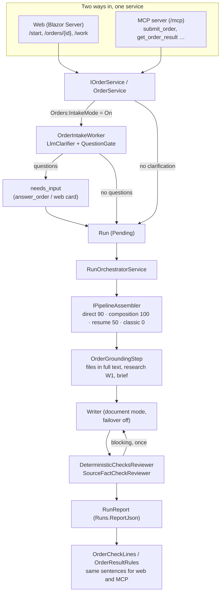

# Guide: building and hosting Atelier

*[Deutsch](15-developer-guide_de.md) · **English***

*Last updated: 2026-11-26*

This guide is for developers and for people who host Atelier. It gives the map of the current system and points to the detailed
documents. Setup commands are in the [README](../README.md); the reasons behind every rule are in the
[decisions log](05-decisions-log.md) (most recently D-067 to D-077).

## The system in one picture

Since the rebuild of November 2026 (D-068), the unit a person sees is the **order**. Runs stay underneath as the technical record
(one run per version). The default way to write is the **direct path**: clarify, look things up if switched on, one writing call
with the files in full text, checks, at most one correction. The older loop of reviewers ("crews") still exists for "Extra
careful" and the older tools.

## Where things live

| Concern | Code |
|---|---|
| Orders, states, versions | `Application/Orders/OrderService.cs`, `Core/Domain/Orders/OrderStateResolver.cs` |
| Questions before the start | `Infrastructure/Intake/LlmClarifier.cs`, `Core/Domain/Intake/QuestionGate.cs`, `Application/Intake/OrderIntakeService.cs` |
| Files | `Infrastructure/Sources/SourceIntakeService.cs` (extraction in a child process), `Infrastructure/Sources/UploadTicketService.cs` |
| Direct path | `Infrastructure/Pipeline/Assembly/DirectPipelineAssembler.cs`, `Infrastructure/Pipeline/Direct/` |
| Checks without a model | `Core/Domain/Checks/RequestConstraintExtractor.cs`, `Infrastructure/Pipeline/Direct/DeterministicChecksReviewer.cs` |
| Fact check | `Infrastructure/Pipeline/Direct/FactCheck/SourceFactCheckReviewer.cs` |
| Research | `Infrastructure/Research/OrderResearchService.cs`, `Core/Domain/Research/DossierBuilder.cs` |
| What the person reads | `Application/Orders/OrderCheckLines.cs`, `Application/Orders/OrderResultRules.cs`, `Web/Components/UI/Orders/` |
| MCP tools and instructions | `Mcp/McpToolCatalog.cs`, `Mcp/McpServerInstructions.cs`, `Mcp/Tools/` |
| Explanation page | `Web/Components/Pages/HowItWorks.razor`, `Web/Display/HowItWorksFeatures.cs` |
| Switches | `Core/Configuration/*Options.cs`, `Web/appsettings.json` |

All paths are below `src/Geef.Atelier.*`.

## The explanation page follows the switches

`/how-it-works` is open without signing in. `HowItWorksFeatureExtensions.FeaturesFor` derives what the page may call available from
the same options and the same exception rules as the application (`OrderOptions.ReviseModeFor`, `ResearchOptions.ModeFor`,
`DirectOptions.FactCheckModeFor`, `UiOptions.ShowsWorkshopEntriesTo`). The pipeline uses the same two helpers for research and
fact check. Rules that are tested (`tests/…/Web/HowItWorks`):

- a feature that is off for the viewer is never shown as available, also when another person has an exception;
- signed out, the page shows the values for everyone; the settings table never shows an exception;
- research counts as available only together with `Orders:IntakeMode = On`;
- a fact-check mode the page does not know is described as "points things out" and never as "may fix";
- switching a feature on for everyone needs no change of the page;
- the example uses the fixed sentences of `OrderCheckLines`, so it cannot drift from the result page.

When you add a switch that changes what a person can do, add it to `HowItWorksFeatures` and to the page in the same change.

## Tests and measurements

- **xUnit + Testcontainers:** `dotnet test` needs a Docker daemon. Prefer real Postgres for anything that touches EF queries or
  migrations.
- **End-to-end over the real wiring:** `tests/Geef.Atelier.Tests/EndToEnd` starts the application against Postgres and replaces
  only the HTTP counterparts (D-067). Every new pipeline path gets a test here.
- **Browser:** Playwright tests in `tests/Geef.Atelier.Tests/Web/E2E` (`WebTestHost`); with `ATELIER_SCREENSHOT_DIR` some of them
  store screenshots.
- **Measuring tools:** `tools/Eval` (blind pairwise comparison), `tools/IntakeEval` (clarifier), `tools/FactCheckEval` (fact check),
  `tools/ResearchEval` (research). Changing the prompt or schema of the clarifier, the fact check or the passage picker makes the
  stored measurement invalid; for the clarifier and the fact check, tests with input hashes turn red until it is measured again.
- **Drift guards for the documentation:** the tool table in [13-ai-assistant-guide.md](13-ai-assistant-guide.md) and its German
  version is compared with the tool catalogue; every guide must exist in both languages and be listed for `/docs`.

## Rules that keep it honest

- Never claim more than was checked; never lose a finding silently. "What was checked" consists of fixed sentences and verbatim
  quotes only, never a model's own words about its work (D-073).
- Fail loud: a missing registration fails at start, a skipped source or failed reviewer becomes a run warning (D-067).
- Migrations are hand-written, additive and idempotent and need `[DbContext]` and `[Migration]`, otherwise EF skips them silently.
- The repository is public: no secrets, no operating details, no account names, no real orders in tests or examples.
- UI texts are English only (D-062); documentation is bilingual (English primary, German `_de.md`).

## Hosting

- Docker Compose with the web service, Postgres (pgvector) and the subscription gateway `cli-proxy`; see the README for the first
  setup, backups and restore.
- Deploy order when both change: first `cli-proxy`, then `web` (D-064, D-066).
- Deploy only when no run is `Pending` or `Running` (D-077).
- After every deploy run `scripts/atelier-smoke.sh` ([ops/atelier-smoke.md](ops/atelier-smoke.md)); `scripts/atelier-watch.sh`
  reports stuck runs and unhealthy services ([ops/atelier-watch.md](ops/atelier-watch.md)).
- Switches: see the [admin guide](14-admin-guide.md#switching-features).
