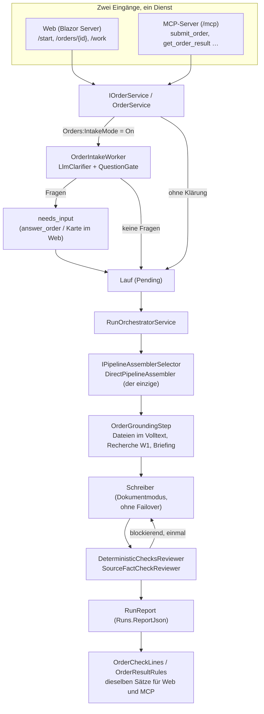

# Leitfaden: Atelier entwickeln und betreiben

***Deutsch** · [English](15-developer-guide.md)*

*Letzte Aktualisierung: 2026-11-27 (D-092: eine Baseline-Migration und der Startschutz; zweiter Zusatz zu D-087: eine Aufstellung, „Extra careful“ entfernt; D-091: Stufe 8d, ein Pipeline-Assembler, zehn MCP-Werkzeuge und fünf Stummel, Altdaten und spätere Datenbankbereinigung; davor Recherche für alle eingeschaltet und ihre Sperren, Zusatz zu D-074; About me am Ergebnis, D-083)*

Dieser Leitfaden ist für Entwicklerinnen und Entwickler und für alle, die Atelier selbst betreiben. Er gibt die Karte des heutigen
Systems und verweist auf die ausführlichen Dokumente. Die Einrichtungsbefehle stehen im [README](../README_de.md); die Gründe
hinter jeder Regel im [Entscheidungslog](05-decisions-log_de.md) (zuletzt D-091, Stufe 8d).

## Das System in einem Bild

Seit dem Umbau im November 2026 (D-068) ist der **Auftrag** die Einheit, die eine Person sieht. Läufe bleiben darunter das
technische Protokoll (ein Lauf je Version). Standard ist der **Direktweg**: klären, nachschlagen (`Research:Mode`, ausgeliefert `On`), ein
Schreibaufruf mit den Dateien im Volltext, Prüfungen, höchstens eine Korrektur. Das ist die einzige Art zu schreiben; die ältere
Prüfschleife und alles, was nur sie nutzte, wurden in Stufe 8d entfernt (D-091).

## Wo was liegt

| Thema | Code |
|---|---|
| Aufträge, Zustände, Versionen | `Application/Orders/OrderService.cs`, `Core/Domain/Orders/OrderStateResolver.cs` |
| Fragen vor dem Start | `Infrastructure/Intake/LlmClarifier.cs`, `Core/Domain/Intake/QuestionGate.cs`, `Application/Intake/OrderIntakeService.cs` |
| Dateien | `Infrastructure/Sources/SourceIntakeService.cs` (Extraktion im Kindprozess), `Infrastructure/Sources/UploadTicketService.cs` |
| Direktweg | `Infrastructure/Pipeline/Assembly/DirectPipelineAssembler.cs`, `Infrastructure/Pipeline/Direct/` |
| Die Aufstellung und die Modelle | `Core/Domain/Crew/SystemCrew.cs`, `Core/Domain/Crew/Models/ModelMatrix.cs`, `Application/Crew/Models/ModelAssignmentService.cs`, `Infrastructure/Crew/ModelCatalog.cs` |
| Läufe ausführen | `Web/Services/RunOrchestratorService.cs` |
| Export | `Application/Orders/IOrderExportService.cs`, `Infrastructure/Orders/` |
| Prüfungen ohne Modell | `Core/Domain/Checks/RequestConstraintExtractor.cs`, `Infrastructure/Pipeline/Direct/DeterministicChecksReviewer.cs` |
| Faktenprüfung | `Infrastructure/Pipeline/Direct/FactCheck/SourceFactCheckReviewer.cs` |
| Recherche | `Infrastructure/Research/OrderResearchService.cs`, `Core/Domain/Research/DossierBuilder.cs` |
| Was die Person liest | `Application/Orders/OrderCheckLines.cs`, `Application/Orders/OrderResultRules.cs`, `Web/Components/UI/Orders/` |
| MCP-Werkzeuge und -Anweisungen | `Mcp/McpToolCatalog.cs`, `Mcp/McpServerInstructions.cs`, `Mcp/Tools/` |
| Erklärseite | `Web/Components/Pages/HowItWorks.razor`, `Web/Display/HowItWorksFeatures.cs` |
| About me am Ergebnis („Tell Atelier once“) | `Application/Orders/AboutMeTopics.cs`, `Application/Orders/AboutMeLines.cs`, `Application/Intake/ProfileMemoryResolution.cs`, `Web/Components/UI/Orders/OrderAboutMe.razor`, `Mcp/Tools/ProfileTool.cs` |
| Schalter | `Core/Configuration/*Options.cs`, `Web/appsettings.json` |

Alle Pfade liegen unter `src/Geef.Atelier.*`.

## Eine Art zu schreiben, eine Aufstellung

`SystemCrew` enthält eine Aufstellung, die nur im Code steht: `direct` (Schreiber, `DeterministicChecksReviewer`,
`SourceFactCheckReviewer`, höchstens eine Korrektur). Jede LLM-Rolle trägt einen `ModelSlot`; das konkrete Modell wird je Lauf aus
`ModelMatrix` und dem Live-Katalog zugewiesen (D-066) und im Snapshot des Laufs eingefroren. Das Grounding eines Laufs ist nur
`OrderGroundingStep` (die Dateien des Auftrags und, falls nachgeschlagen wurde, die Stellen) und die Web-Recherche
(`OrderResearchService` mit dem Tavily-Client; `Research:*`, `Tavily:Endpoint`, `Tavily:ApiKey`). Ein Start ohne Suchschlüssel
schreibt eine Warnung ins Log, und die Recherche endet dann ohne Suche.

`PipelineAssemblerSelector` fragt die registrierten Assembler; der einzige produktive, `DirectPipelineAssembler`, nimmt `direct`
an. Ein Lauf, den keiner annimmt, scheitert mit „This task was set up in a way this version cannot run. Please start it again.“

## MCP-Werkzeuge

Der Server bietet `submit_order`, `answer_order`, `get_order_status`, `get_order_result`, `list_orders`, `cancel_order`,
`revise_order`, `export_order` und `profile` an sowie `prepare_attachment`, solange `Uploads:Tickets` `On` ist (`McpToolCatalog`).
`Mcp/Tools/RetiredTools.cs` behält `submit_request`, `submit_auto_crew_request`, `get_run_status`, `get_run_result` und
`get_run_details` für eine Version: optionale Parameter, eine Beschreibung, die mit „Removed: use … instead.“ beginnt, und jeder
Aufruf scheitert mit einer Fehlermeldung, die den Nachfolger nennt.

## Datenbank und Migrationen

Eine Migration, `Baseline` (D-092), baut das Schema aus einer leeren Datenbank auf, mit den Seeds, die eine frische Installation
braucht; der Modell-Snapshot passt zum Modell (`BaselineMigrationTests`). Spätere Änderungen kommen als Migrationen darauf, von
Hand geschrieben oder mit `dotnet ef migrations add` erzeugt; wo es geht additiv, damit das vorige Image weiterläuft. Auf einer
Datenbank, die nicht von der Baseline ausgeht, startet die Anwendung nicht (`EnsureStartsFromBaselineAsync`) und ändert nichts
daran; eine Installation von vor D-092 muss erst umgestellt werden.

## Die Erklärseite folgt den Schaltern

`/how-it-works` ist ohne Anmeldung erreichbar. `HowItWorksFeatureExtensions.FeaturesFor` leitet ab, was die Seite als verfügbar
bezeichnen darf – aus denselben Optionen und denselben Ausnahmeregeln wie die Anwendung (`OrderOptions.ReviseModeFor`,
`ResearchOptions.ModeFor`, `DirectOptions.FactCheckModeFor`). Die Pipeline nutzt dieselben beiden Hilfen für Recherche und
Faktenprüfung. Getestete Regeln (`tests/…/Web/HowItWorks`):

- eine Funktion, die für die betrachtende Person aus ist, erscheint nie als verfügbar, auch wenn eine andere Person eine Ausnahme
  hat;
- abgemeldet zeigt die Seite die Werte für alle; die Tabelle mit Einstellungsnamen und Rohwerten erscheint nur für Administratoren
  und zeigt nie eine Ausnahme;
- Recherche gilt nur zusammen mit `Orders:IntakeMode = On` als verfügbar: Die Aufstellung hat keine eigene Grounding-Quelle, der
  einzige Webzugang ist `OrderResearchService`, und er sucht nur für einen Auftrag, in dessen Verlauf der Rückfragen steht, dass die
  Recherche beim Lesen der Anfrage für die Person eingeschaltet war;
- Suchthemen prüft `ResearchQueryGate` zweimal: beim Lesen des Auftrags gegen die About-me-Angaben, die der Klärer sah (dort
  zurückgehaltene Themen zählt `IntakeRecord.ResearchWithheld`), und im Lauf gegen die Angaben des Briefings;
- einen unbekannten Modus der Faktenprüfung beschreibt die Seite als „meldet“, nie als „korrigiert“;
- Einschalten für alle braucht keine Änderung an der Seite;
- der Kasten „What was checked“ im Beispiel nutzt die festen Sätze aus `OrderCheckLines`; die Einleitungen der offenen Punkte und
  der Annahmen vergleicht ein Test mit `OrderOpenPoints.razor` und `OrderAssumptions.razor`.

Wer einen Schalter ergänzt, der ändert, was eine Person tun kann, nimmt ihn in derselben Änderung in `HowItWorksFeatures` und in
die Seite auf.

## Tests und Messungen

- **xUnit + Testcontainers:** `dotnet test` braucht einen Docker-Daemon. Für alles, was EF-Abfragen oder Migrationen berührt,
  echtes Postgres bevorzugen.
- **Ende-zu-Ende über die echte Verdrahtung:** `tests/Geef.Atelier.Tests/EndToEnd` startet die Anwendung gegen Postgres und
  ersetzt nur die HTTP-Gegenstellen (D-067). Jeder neue Pipeline-Weg bekommt hier einen Test.
- **Browser:** Playwright-Tests in `tests/Geef.Atelier.Tests/Web/E2E` (`WebTestHost`); mit `ATELIER_SCREENSHOT_DIR` legen einige
  davon Bildschirmfotos ab.
- **Messwerkzeuge:** `tools/Eval` (blinder Paarvergleich), `tools/IntakeEval` (Klärer), `tools/FactCheckEval` (Faktenprüfung),
  `tools/ResearchEval` (Recherche). Eine Änderung an Prompt oder Schema von Klärer, Faktenprüfer oder Stellenauswahl macht die
  gespeicherte Messung ungültig; für Klärer und Faktenprüfer werden Tests mit Eingabe-Hashes rot, bis neu gemessen ist.
- **Drift-Schutz für die Doku:** Die Werkzeugtabelle in [13-ai-assistant-guide_de.md](13-ai-assistant-guide_de.md) und ihrer
  englischen Fassung wird mit den Werkzeugen verglichen, die der Server anbietet, ohne die Stummel; jeder Leitfaden muss in beiden Sprachen existieren und für `/docs`
  eingetragen sein. Jedes unter `/docs` ausgelieferte Dokument wird in einem Test gerendert: Mermaid-Blöcke und HTML-Kommentare
  fallen weg (GitHub zeichnet die Diagramme), Links auf freigegebene Dokumente führen nach `/docs/…`, Links auf andere Dateien des
  Repositorys zu GitHub, und Links in die nicht veröffentlichten Arbeitsordner werden zu reinem Text.

## Regeln, die es ehrlich halten

- Nie mehr behaupten, als geprüft wurde; nie einen Befund still verlieren. „What was checked“ besteht nur aus festen Sätzen und
  wörtlichen Zitaten, nie aus eigenen Worten eines Modells über seine Arbeit (D-073).
- Laut statt still: Eine fehlende Registrierung scheitert beim Start, eine übersprungene Quelle oder ein ausgefallener Prüfer wird
  zur Warnung am Lauf (D-067).
- Eine handgeschriebene Migration braucht `[DbContext]` und `[Migration]`, sonst überspringt EF sie still; der Modell-Snapshot muss
  Schritt halten (`BaselineMigrationTests` schlägt fehl, wenn Modell und Migrationen abweichen).
- Das Repository ist öffentlich: keine Geheimnisse, keine Betriebsdetails, keine Kontonamen, keine echten Aufträge in Tests oder
  Beispielen.
- UI-Texte nur Englisch (D-062); Doku zweisprachig (Englisch führend, Deutsch als `_de.md`).
- About me ist streng je Konto: Die Ergebnisfelder `TellOnce` und `FromAboutMe` werden nur für die Person gefüllt, der der Auftrag
  gehört, die Web-Komponente erscheint nur ihr, und `IProfileService.SavePartAsync` sowie `profile` schreiben nur in das Profil der
  angemeldeten Person, und nur in leere Felder, in einer gesperrten Anweisung (`IUserProfileRepository.FillEmptyAsync`); Name, Tätigkeit
  und Organisation sind eine Zeile ohne Steuerzeichen, und keine Zeile der Unterschrift darf mit einem Feldnamen aus
  `ProfilePrompt.Labels` beginnen. Die Themen kommen aus dem gespeicherten Lesen des Auftrags (`IntakeRecord`) und dem Profilblock des
  gespeicherten Briefings, nie aus Wörtern im Text; Klärer-Prompt und Briefing von Aufträgen ohne ein solches Thema bleiben
  unverändert (D-083).

## Betrieb

- Docker Compose mit Webdienst, Postgres, Backup-Container und dem CLI-Gateway `cli-proxy`; Ersteinrichtung, Sicherung und
  Wiederherstellung im README. Die Compose-Dateien nutzen ein `pgvector`-Postgres-Image; das Schema braucht keine Erweiterung (D-092).
- Ändern sich beide, gilt die Reihenfolge: erst `cli-proxy`, dann `web` (D-064, D-066).
- Nur ausliefern, wenn kein Lauf `Pending` oder `Running` ist (D-077).
- Nach jedem Deploy `scripts/atelier-smoke.sh` ausführen ([ops/atelier-smoke.md](ops/atelier-smoke.md)); `scripts/atelier-watch.sh`
  meldet hängende Läufe und ungesunde Dienste ([ops/atelier-watch.md](ops/atelier-watch.md)).
- Schalter: siehe [Leitfaden für die Administration](14-admin-guide_de.md#funktionen-schalten).
