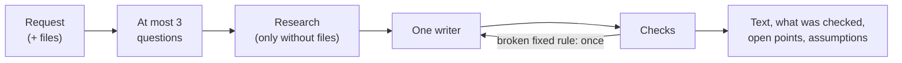

# Version 2: what changed

*[Deutsch](16-version-2_de.md) · **English***

*Last updated: 2026-11-28*

**Version 2.0.0 is a major update.** The configurable crews are gone. Instead of putting together who writes and who reviews,
you say what you need, answer at most three questions and get a text with a report. Almost every page, most MCP tools and the
database changed. **Version 1 cannot be upgraded in place.**

## Looking for version 1?

Version 1 is the **version with configurable crews**, for example the one an article about Geef.Atelier describes.

| You want to … | Go here |
|---|---|
| read the code of version 1 | **[Browse version 1](https://github.com/chr0mcom/geef-atelier/tree/v1.0.0)** (tag `v1.0.0`) |
| see the release with its notes | [Release v1.0.0](https://github.com/chr0mcom/geef-atelier/releases/tag/v1.0.0) |
| try it on your own computer | the notes at the top of its [README](https://github.com/chr0mcom/geef-atelier/blob/v1.0.0/README.md) |
| see the original state, unchanged | [commit `ad732037`](https://github.com/chr0mcom/geef-atelier/tree/ad732037f49b044ecfc44ad92774d3ada55117c6) (23 November 2026) |
| follow every change since then | [compare `ad732037` with `v2.0.0`](https://github.com/chr0mcom/geef-atelier/compare/ad732037f49b044ecfc44ad92774d3ada55117c6...v2.0.0) |

**Where it is in the history:** every commit up to and including `ad732037` belongs to version 1. The rebuild starts with the
commits after it, from 24 November 2026.

The tag `v1.0.0` (branch `v1`) is that state with a few changes so that it can still be tried: a notice in the README, a fix so
that it builds again, a local setup that is reachable only from your own computer and has names of its own, and two removed
addresses. **Version 1 is no longer maintained. It has known faults and security gaps that are fixed only in version 2, so do not
run it where others can reach it.**

## The change at a glance

| | Version 1 | Version 2 |
|---|---|---|
| How you order a text | a form with one briefing field and a choice of crew | your request in your own words, with up to 10 files |
| Questions back | none | 0 to 3, can always be skipped |
| Who writes and checks | a crew: one executor, several reviewers, optional advisors | one writer, fixed checks, one fact checker |
| Repetition | a loop, by default up to 6 rounds, up to 12 in one template | at most one correction |
| No agreement | the run ended as “Failed” although there was a text | the text is delivered with its open points |
| Changing a result | resume a run, without a field for what to change | **Change something**, up to 10 versions |
| What it knows about you | learnings it collected by itself | **About me**, filled in by you |
| MCP tools | 19 | 10, plus 5 placeholders for old names (for one version) |
| Database | 34 tables, 39 migrations | 22 tables, one baseline migration |
| System templates | 5 in code and 1 in the database | 1, in code only |
| Pages with their own address (page files) | 59 | 31 |

## Why

An analysis of version 1 found that attached files, web search and learnings had stopped reaching the models without any visible
error ([D-067](05-decisions-log.md#d-067--stage-0-safety-net-2026-11-24)). In a small measurement on eleven real requests, asking a
few questions beat plain assuming 9 : 1, while an extra review round and a rewritten request without new information did not
improve the judgement ([D-068](05-decisions-log.md#d-068--direction-of-the-rebuild-order-direct-path-questions-sources-memory-2026-11-24)).
The goal of version 2: even a short, weak request should give a good result in minutes, without invented facts and with its
assumptions named.

## How it works now

- **Questions** come only before writing, with answers to click. Whoever skips is not committed to a yes, a no, an order or a
  payment (this is an instruction to the writer, not a guarantee). Requests longer than 8,000 characters start without questions.
- **Research** happens only for the first version, only without files, and only for search topics found while the request was
  read; requests over 8,000 characters are therefore never researched. Only passages found word for word on a page are shown.
  It needs a search key (`TAVILY_API_KEY`).
- **Files:** up to 150,000 characters (all files of one order together) the writer gets the full text. Up to 600,000 it also gets
  a document map; **then the facts in the text are no longer compared with your files**, and the result says so. Above that you
  select PDF pages or shorten.
- **Checks:** rules read from your request (for example length, language or forbidden words) are checked without AI and can
  trigger one correction. A second model checks facts. As shipped it **only reports** what it finds and does not change the text.
- **Result:** the text, **What was checked** (with the sentence that this does not prove the text is right), open points,
  assumptions, and export as Word, PDF or Markdown.

## What is new

| New | What it does | Decision |
|---|---|---|
| Orders | One place per request with all its versions (`/start`, `/work`, `/orders/{id}`). | D-070 |
| Files with a receipt | Each file is uploaded on its own; you see what could be read. Word files are new. | D-069, D-070 |
| Questions before writing | At most three, filtered so that unnecessary ones are dropped. | D-071, D-072, D-081 |
| Honest results | Missing facts stay as placeholders; the report names only checks that really ran. | D-069, D-073 |
| Research with quotes | Passages with page and date; you see the search words that were sent. | D-074 |
| Change something | Shorter, more formal, friendlier, simpler words, or your own wish. | D-075, D-078 |
| About me and “Tell Atelier once” | Your own details; a missing sender or signature can be saved from a result. | D-071, D-083 |
| Files over MCP | A one-time upload command or an upload page, so files do not pass through the model. | D-076 |
| MCP skill and forms | The server ships the skill `using-atelier`; suitable clients show the questions as a form. | D-086, D-088 |
| How it works and guides | A public page and guides for users, AI assistants, administrators and developers. | D-080, D-084 |
| Warnings and safeguards | What a run skips is shown; silent fallbacks became errors. | D-067 |
| Gateway: same model only | `x-cli-proxy-failover: same-model` moves a request only between accounts of the same CLI. | D-090 |

Version 2 also closes security gaps of version 1.

## What is gone, and what you use instead

| Removed | Instead |
|---|---|
| Crew templates (`klassik`, `juristisch`, `akademisch`, `marketing`, your own) | one way of writing. **There is no choice of a legal, academic or marketing team.** |
| Executor, reviewer and advisor profiles with their editors | nothing comparable |
| Specialization packs | nothing |
| Tool system and external MCP servers | nothing |
| All grounding provider types | files in full text and one research step |
| Knowledge base, embeddings, vector search | files per order |
| Learning loop | **About me** and “Tell Atelier once” |
| Auto-crew composer and Template Studio | nothing; there is nothing left to put together |
| Finalizers and run artifacts | export as Word, PDF or Markdown |
| HTML, text and JSON export, metadata, webhook and e-mail | removed |
| AI transformations such as summary or glossary | **Change something** with your own wish |
| The old review loop and “Extra careful” | the one way of writing ([D-087](05-decisions-log.md#d-087--new-extra-careful-direct-path-with-an-outline-behind-a-switch-measurement-prepared-2026-11-27)) |
| Workshop dashboard and the form `/new` | **My work** and `/start` |
| Editor for HTTP providers | providers over the command line can still be set up |

Removed in [D-089](05-decisions-log.md#d-089--cleanup-cut-1-code-nobody-used-is-removed-2026-11-27) and
[D-091](05-decisions-log.md#d-091--cleanup-cut-2-only-the-standard-way-remains-2026-11-27). Accounts, sign-in with OAuth,
providers over the command line, the model matrix, the list of runs and the gateway stay.

## For AI assistants and MCP clients

| Version 1 | Version 2 |
|---|---|
| `submit_request`, `submit_auto_crew_request` | `submit_order` |
| `get_run_status` | `get_order_status` |
| `get_run_result`, `get_run_details` | `get_order_result` |
| `list_runs` | `list_orders` |
| `cancel_run` | `cancel_order` |
| `list_run_artifacts`, `download_run_artifact` | `export_order` |
| `list_crew_templates`, `list_reviewer_profiles`, `list_advisor_profiles`, `list_grounding_provider_profiles`, `list_providers`, `get_provider_models`, `list_knowledge_documents`, `list_learnings`, `analyze_template_proposal`, `materialize_template_proposal` | removed |
| | new: `answer_order`, `revise_order`, `prepare_attachment`, `profile` |

For one version, `submit_request`, `submit_auto_crew_request`, `get_run_status`, `get_run_result` and `get_run_details` still
exist as placeholders: every call fails with a message that names the successor. A cached `submit_order` call with
`extraCareful=true` is refused. Details: [guide for AI assistants](13-ai-assistant-guide.md) and
[MCP integration](04-mcp-integration.md).

## Moving from version 1 to version 2

**There is no automatic upgrade.** Version 2 starts from a new database baseline
([D-092](05-decisions-log.md#d-092--database-and-file-store-cleanup-one-baseline-migration-2026-11-27)). On a database of
version 1 it stops at start-up and changes nothing. Plan it as a new installation:

1. Back up the database of version 1, and keep the backup if you may want to go back.
2. Give version 2 an **empty database**. The Compose file uses the same project and volume names as version 1, so the old
   database volume would otherwise be picked up again. Remove it only after you have checked your backup: version 2 cannot read
   it. The same applies to the local development setup if you ran version 1 from a commit other than the tag `v1.0.0`.
3. Follow the [setup in the README](../README.md#production-deployment). New in `.env` is `ATELIER_INTERNAL_API_TOKEN`. Research is
   shipped switched on: set `TAVILY_API_KEY` or switch it off (`Research__Mode=Off`).
4. Users, connected AI assistants and OAuth clients have to be set up again, and custom crews, profiles, knowledge documents and
   earlier runs do not come along.

## Every decision, in order

The [decisions log](05-decisions-log.md) explains every step with its reasons and measurements. The rebuild is **D-067 to
D-092**:

| Decisions | Topic |
|---|---|
| D-067, D-068 | safety net and direction of the rebuild |
| D-069, D-070 | the direct way of writing, orders, files |
| D-071, D-072 | questions before writing |
| D-073 | honest writing and the fact check |
| D-074 | research |
| D-075 | changing a result, MCP tools for orders |
| D-076 | files over MCP |
| D-077, D-078 | closing the first part, then completing and switching on |
| D-079 | no unwanted web search |
| D-080, D-084 | public page, guides, new start page |
| D-081, D-082, D-083 | skipping never commits; a number correction that was not shipped; “Tell Atelier once” |
| D-085, D-087 | attempts to keep a more thorough way, measured and removed |
| D-086, D-088 | MCP instructions, skill and forms |
| D-089, D-091 | removal of the old way |
| D-090 | gateway failover to the same model only |
| D-092 | database cleanup |
