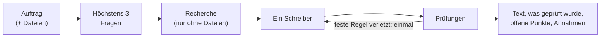

# Version 2: Was sich geändert hat

***Deutsch** · [English](16-version-2.md)*

*Letzte Aktualisierung: 2026-11-28*

**Version 2.0.0 ist ein großes Update (Major Update).** Die einstellbaren Crews gibt es nicht mehr. Statt festzulegen, wer
schreibt und wer prüft, sagst du, was du brauchst, beantwortest höchstens drei Fragen und bekommst einen Text mit Bericht. Fast
jede Seite, die meisten MCP-Werkzeuge und die Datenbank haben sich geändert. **Ein Upgrade von Version 1 am Ort gibt es nicht.**

## Du suchst Version 1?

Version 1 ist die **Version mit den einstellbaren Crews**, zum Beispiel die, die ein Artikel über Geef.Atelier beschreibt.

| Du willst … | Hier entlang |
|---|---|
| den Code von Version 1 lesen | **[Version 1 ansehen](https://github.com/chr0mcom/geef-atelier/tree/v1.0.0)** (Tag `v1.0.0`) |
| das Release mit Hinweisen sehen | [Release v1.0.0](https://github.com/chr0mcom/geef-atelier/releases/tag/v1.0.0) |
| sie auf dem eigenen Rechner ausprobieren | die Hinweise oben in ihrer [Readme](https://github.com/chr0mcom/geef-atelier/blob/v1.0.0/README_de.md) |
| den ursprünglichen Stand unverändert sehen | [Commit `ad732037`](https://github.com/chr0mcom/geef-atelier/tree/ad732037f49b044ecfc44ad92774d3ada55117c6) (23. November 2026) |
| sehen, was sich im Code geändert hat | [Vergleich `ad732037` mit `v2.0.0`](https://github.com/chr0mcom/geef-atelier/compare/ad732037f49b044ecfc44ad92774d3ada55117c6...v2.0.0) (GitHub kürzt große Vergleiche; alle Commits: [Historie von `v2.0.0`](https://github.com/chr0mcom/geef-atelier/commits/v2.0.0)) |

**Wo das in der Historie liegt:** Jeder Commit bis einschließlich `ad732037` gehört zu Version 1. Der Umbau beginnt mit den
Commits danach, ab dem 24. November 2026.

Der Tag `v1.0.0` (Zweig `v1`) ist dieser Stand mit wenigen Änderungen, damit er sich noch ausprobieren lässt: ein Hinweis in der
Readme, eine Korrektur, damit er wieder baut, ein lokaler Aufbau, der nur vom eigenen Rechner aus erreichbar ist und eigene
Namen hat, und zwei entfernte Adressen. **Version 1 wird nicht mehr gepflegt. Sie hat bekannte Fehler und Sicherheitslücken, die
nur in Version 2 behoben sind. Betreibe sie deshalb nirgends, wo andere sie erreichen.**

## Der Wandel auf einen Blick

| | Version 1 | Version 2 |
|---|---|---|
| So bestellst du einen Text | Formular mit einem Briefing-Feld, bis zu 5 Anhängen (Markdown, Text, PDF) und Wahl der Crew | dein Auftrag in eigenen Worten, mit bis zu 10 Dateien |
| Rückfragen | keine | 0 bis 3, immer überspringbar |
| Wer schreibt und prüft | eine Crew: ein Executor, mehrere Reviewer, wahlweise Berater | ein Schreiber, feste Prüfungen, ein Faktenprüfer |
| Wiederholungen | eine Schleife, in der Regel bis zu 6 Runden, in einer Vorlage bis zu 12 | höchstens eine Korrektur |
| Keine Einigung | der Lauf endete als „Failed“, obwohl es einen Text gab | der Text wird mit seinen offenen Punkten geliefert |
| Ergebnis ändern | Lauf fortsetzen, ohne Feld für den Änderungswunsch | **Change something**, bis zu 10 Versionen |
| Wissen über dich | selbst gesammelte Learnings | **About me**, von dir ausgefüllt |
| MCP-Werkzeuge | 19 (ihre Readme nennt noch 15) | 10, dazu 5 Platzhalter für alte Namen (für eine Version) |
| Datenbank | 34 Tabellen, 39 Migrationen | 22 Tabellen, eine Ausgangsmigration |
| Systemvorlagen | 5 im Code und 1 in der Datenbank | 1, nur im Code |
| Seiten mit eigener Adresse (Seitendateien) | 59 | 31 |

Die Oberfläche ist englisch; die Namen der Knöpfe stehen deshalb auf Englisch.

## Warum

Eine Analyse von Version 1 ergab, dass angehängte Dateien, Websuche und Learnings die Modelle nicht mehr erreichten, ohne dass
ein Fehler sichtbar wurde ([D-067](05-decisions-log_de.md#d-067--etappe-0-sicherheitsnetz-2026-11-24)). In einer kleinen Messung
mit elf echten Aufträgen schlugen wenige Rückfragen das bloße Annehmen mit 9 : 1. Eine zusätzliche Prüfrunde und ein
umformulierter Auftrag ohne neue Information verbesserten das Urteil dagegen nicht
([D-068](05-decisions-log_de.md#d-068--richtung-umbau-auftrag-direktweg-rückfragen-quellen-gedächtnis-2026-11-24)).
Das Ziel von Version 2: Auch ein kurzer, schwacher Auftrag soll in Minuten ein gutes Ergebnis geben, ohne erfundene Fakten und
mit benannten Annahmen.

## So funktioniert es jetzt



- **Rückfragen** kommen nur vor dem Schreiben, mit Antworten zum Anklicken. Wer überspringt, wird auf keine Zusage, Absage,
  Bestellung oder Zahlung festgelegt (eine Anweisung an den Schreiber, keine Garantie). Aufträge über 8.000 Zeichen starten ohne
  Rückfragen.
- **Recherche** gibt es nur für die erste Version, nur ohne Dateien und nur zu Suchthemen, die beim Lesen des Auftrags gefunden
  wurden; Aufträge über 8.000 Zeichen werden deshalb nie recherchiert. Gezeigt werden nur Stellen, die wörtlich auf einer Seite
  stehen. Dafür braucht es einen Suchschlüssel (`TAVILY_API_KEY`).
- **Dateien:** Bis 150.000 Zeichen (alle Dateien eines Auftrags zusammen) bekommt der Schreiber den Volltext. Bis 600.000 kommt
  eine Dateikarte dazu; **dann werden die Fakten im Text nicht mehr mit deinen Dateien verglichen**, und das Ergebnis sagt das.
  Darüber wählst du PDF-Seiten aus oder kürzt.
- **Prüfungen:** Regeln aus deinem Auftrag (zum Beispiel Länge, Sprache oder verbotene Wörter) werden ohne KI geprüft und können
  eine Korrektur auslösen. Ein zweites Modell prüft die Fakten. Im ausgelieferten Stand **meldet es nur**, was es findet, und
  ändert den Text nicht.
- **Ergebnis:** der Text, **What was checked** (mit dem Satz, dass das nicht beweist, dass der Text stimmt), offene Punkte,
  Annahmen und Export als Word, PDF oder Markdown.

## Was neu ist

| Neu | Was es tut | Entscheidung |
|---|---|---|
| Aufträge | Ein Ort je Auftrag mit allen Versionen (`/start`, `/work`, `/orders/{id}`). | D-070 |
| Dateien mit Quittung | Jede Datei wird einzeln hochgeladen; du siehst, was gelesen werden konnte. Word-Dateien sind neu. | D-069, D-070 |
| Rückfragen vor dem Schreiben | Höchstens drei, gefiltert, damit unnötige wegfallen. | D-071, D-072, D-081 |
| Ehrliche Ergebnisse | Fehlende Fakten bleiben Platzhalter; der Bericht nennt nur Prüfungen, die wirklich liefen. | D-069, D-073 |
| Recherche mit Belegen | Stellen mit Seite und Datum; du siehst die gesendeten Suchwörter. | D-074 |
| Change something | Kürzer, förmlicher, freundlicher, einfachere Wörter oder dein eigener Wunsch. | D-075, D-078 |
| About me und „Tell Atelier once“ | Eigene Angaben; fehlende Absender oder Unterschriften lassen sich am Ergebnis speichern. | D-071, D-083 |
| Dateien über MCP | Ein einmaliger Upload-Befehl oder eine Upload-Seite, damit Dateien nicht durch das Modell laufen. | D-076 |
| MCP-Skill und Formulare | Der Server liefert den Skill `using-atelier` mit; passende Clients zeigen die Fragen als Formular. | D-086, D-088 |
| How it works und Leitfäden | Eine öffentliche Seite und Leitfäden für Anwender, KI-Assistenten, Administration und Entwicklung. | D-080, D-084 |
| Warnungen und Sicherungen | Was ein Lauf auslässt, wird angezeigt; stille Ersatzwege wurden zu Fehlern. | D-067 |
| Gateway: nur dasselbe Modell | `x-cli-proxy-failover: same-model` verschiebt eine Anfrage nur zwischen Konten derselben CLI. | D-090 |

Version 2 schließt außerdem Sicherheitslücken von Version 1.

## Was weggefallen ist und was du stattdessen nutzt

| Entfernt | Stattdessen |
|---|---|
| Crew-Vorlagen (`klassik`, `juristisch`, `akademisch`, `marketing`, eigene) | ein Weg zu schreiben. **Eine Wahl zwischen juristischem, akademischem oder Marketing-Team gibt es nicht.** |
| Profile für Executor, Reviewer und Berater samt Editoren | nichts Vergleichbares |
| Spezialisierungs-Packs | nichts |
| Tool-System und externe MCP-Server | nichts |
| Alle Typen von Grounding-Providern | Dateien im Volltext und ein Rechercheschritt |
| Wissensbasis, Embeddings, Vektorsuche | Dateien je Auftrag |
| Lernschleife | **About me** und „Tell Atelier once“ |
| Auto-Crew-Composer und Template Studio | nichts; es gibt nichts mehr zusammenzustellen |
| Finalizer und Run-Artefakte | Export als Word, PDF oder Markdown |
| Export als HTML, Text und JSON, Metadaten, Webhook und E-Mail | entfallen |
| KI-Umformungen wie Zusammenfassung oder Glossar | **Change something** mit eigenem Wunsch |
| Die Prüfschleife (im Umbau zeitweise als „Extra careful“ wählbar) | der eine Weg zu schreiben ([D-087](05-decisions-log_de.md#d-087--neues-extra-careful-direktweg-mit-gliederung-hinter-schalter-messung-vorbereitet-2026-11-27)) |
| Workshop-Dashboard und das Formular `/new` | **My work** und `/start` |
| Editor für HTTP-Provider | Anbieter über die Kommandozeile lassen sich weiter einrichten |

Entfernt in [D-089](05-decisions-log_de.md#d-089--rückbau-schnitt-1-ungenutzter-code-entfernt-2026-11-27) und
[D-091](05-decisions-log_de.md#d-091--rückbau-schnitt-2-nur-der-standardweg-bleibt-2026-11-27). Konten, Anmeldung mit OAuth,
Anbieter über die Kommandozeile, die Modellmatrix, die Laufliste und das Gateway bleiben.

## Für KI-Assistenten und MCP-Clients

| Version 1 | Version 2 |
|---|---|
| `submit_request`, `submit_auto_crew_request` | `submit_order` |
| `get_run_status` | `get_order_status` |
| `get_run_result`, `get_run_details` | `get_order_result` |
| `list_runs` | `list_orders` |
| `cancel_run` | `cancel_order` |
| `list_run_artifacts`, `download_run_artifact` | `export_order` |
| `list_crew_templates`, `list_reviewer_profiles`, `list_advisor_profiles`, `list_grounding_provider_profiles`, `list_providers`, `get_provider_models`, `list_knowledge_documents`, `list_learnings`, `analyze_template_proposal`, `materialize_template_proposal` | entfallen |
| | neu: `answer_order`, `revise_order`, `prepare_attachment`, `profile` |

Für eine Version gibt es `submit_request`, `submit_auto_crew_request`, `get_run_status`, `get_run_result` und `get_run_details`
noch als Platzhalter: Jeder Aufruf scheitert mit einer Meldung, die den Nachfolger nennt. Ein zwischengespeicherter Aufruf von
`submit_order` mit `extraCareful=true` wird abgelehnt. Einzelheiten: [Leitfaden für KI-Assistenten](13-ai-assistant-guide_de.md)
und [MCP-Integration](04-mcp-integration_de.md).

## Umstieg von Version 1 auf Version 2

**Ein automatisches Upgrade gibt es nicht.** Version 2 beginnt mit einer neuen Ausgangsmigration der Datenbank
([D-092](05-decisions-log_de.md#d-092--datenbank-und-dateiablage-aufgeräumt-eine-baseline-migration-2026-11-27)). Auf einer
Datenbank von Version 1 bricht sie beim Start ab und ändert nichts. Plane den Umstieg wie eine Neuinstallation:

1. Sichere die Datenbank, solange Version 1 noch läuft, und kopiere die Sicherung **aus Docker heraus**. Die eingebauten
   Sicherungen liegen im Volume `geef-atelier_geef-atelier-backups`, das zum selben Compose-Projekt gehört:
   ```bash
   docker compose exec postgres-backup /backup.sh
   docker compose exec postgres-backup ls -lh /backups/last/
   docker cp geef-atelier-postgres-backup:/backups/last/<datei>.sql.gz ./
   gunzip -t <datei>.sql.gz     # prüft, ob die Kopie vollständig ist
   ```
   Nimm eine Datei mit Datum im Namen, nicht den Verweis, der auf `-latest.sql.gz` endet. Behalte diese Kopie, falls du zurück
   willst: Version 2 schreibt ihre eigenen Sicherungen in dasselbe Volume und räumt ältere mit der Zeit weg.
2. Gib Version 2 eine **leere Datenbank**. Die Compose-Datei verwendet dieselben Projekt- und Volume-Namen wie Version 1; ohne
   diesen Schritt wird deshalb das alte Datenbank-Volume wieder verwendet. Entferne nach geprüfter Kopie **nur** das
   Datenbank-Volume:
   ```bash
   docker compose down     # nie "down -v": das löscht auch die Sicherungen, die Anmeldungen der KI-Werkzeuge und die Cookie-Schlüssel
   docker volume rm geef-atelier_geef_atelier_postgres_data
   ```
   Version 2 kann das alte Volume nicht lesen. Das gilt auch für den lokalen Entwicklungsaufbau (Volume
   `geef-atelier-dev_postgres_dev_data`), wenn du Version 1 aus einem anderen Stand als dem Tag `v1.0.0` betrieben hast.
3. Folge der [Einrichtung in der Readme](../README_de.md#production-deployment). Neu in `.env` ist `ATELIER_INTERNAL_API_TOKEN`.
   Die Recherche ist eingeschaltet ausgeliefert: Setze `TAVILY_API_KEY` in `.env` oder schalte sie mit `Research__Mode=Off`
   unter `services.web.environment` in `docker-compose.override.yml` aus (eine Zeile in `.env` allein erreicht den Web-Dienst
   nicht).
4. Benutzer, verbundene KI-Assistenten und OAuth-Clients müssen neu eingerichtet werden, die Betreiberangaben für
   Impressum und Datenschutz (`/admin/site-settings`) und eigene Anbieter neu eingetragen werden. Eigene Crews, Profile, Wissensdokumente
   und frühere Läufe kommen nicht mit.

## Alle Entscheidungen der Reihe nach

Das [Entscheidungslog](05-decisions-log_de.md) erklärt jeden Schritt mit Gründen und Messungen. Der Umbau umfasst **D-067 bis
D-092**:

| Entscheidungen | Thema |
|---|---|
| D-067, D-068 | Sicherheitsnetz und Richtung des Umbaus |
| D-069, D-070 | der direkte Weg zu schreiben, Aufträge, Dateien |
| D-071, D-072 | Rückfragen vor dem Schreiben |
| D-073 | ehrliches Schreiben und Faktenprüfung |
| D-074 | Recherche |
| D-075 | Ergebnisse ändern, MCP-Werkzeuge für Aufträge |
| D-076 | Dateien über MCP |
| D-077, D-078 | Abschluss des ersten Teils, dann Fertigstellen und Einschalten |
| D-079 | keine ungewollte Websuche |
| D-080, D-084 | öffentliche Seite, Leitfäden, neue Startseite |
| D-081, D-082, D-083 | Überspringen legt nie fest; eine nicht ausgelieferte Zahlenkorrektur; „Tell Atelier once“ |
| D-085, D-087 | Versuche, einen gründlicheren Weg zu behalten, gemessen und wieder entfernt |
| D-086, D-088 | MCP-Hinweise, Skill und Formulare |
| D-089, D-091 | Rückbau des alten Wegs |
| D-090 | Failover des Gateways nur auf dasselbe Modell |
| D-092 | Datenbank aufgeräumt |
